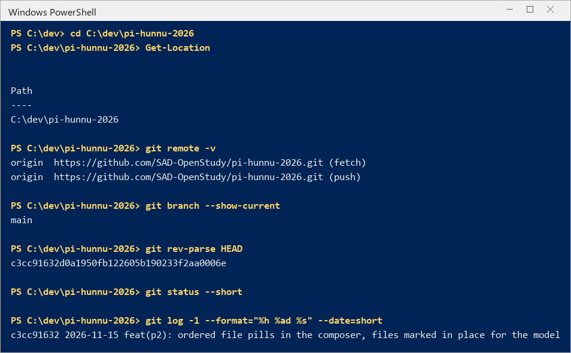
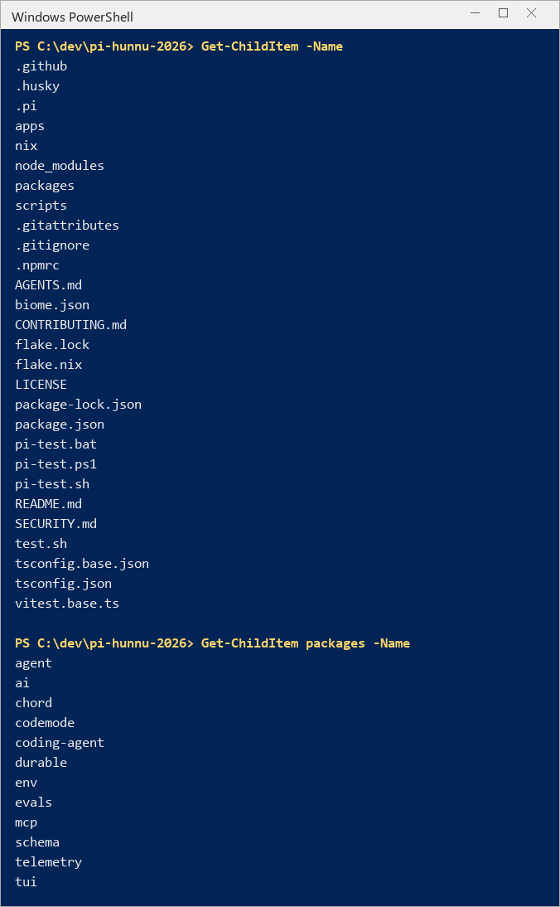
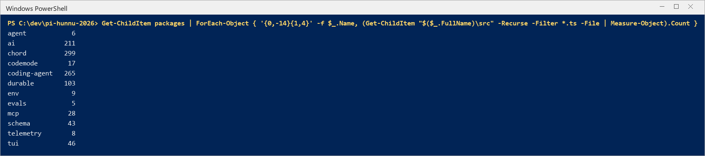
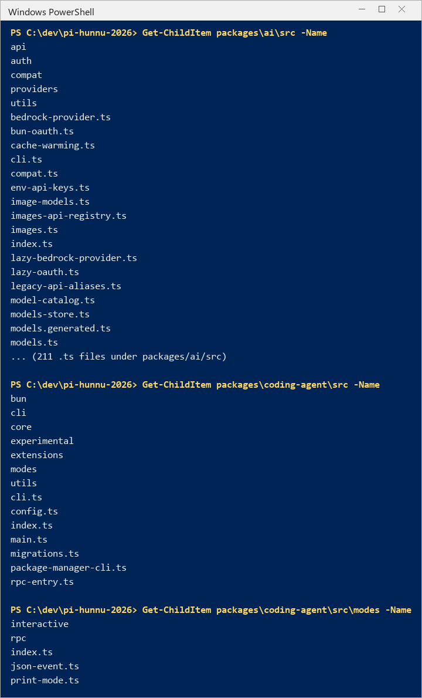
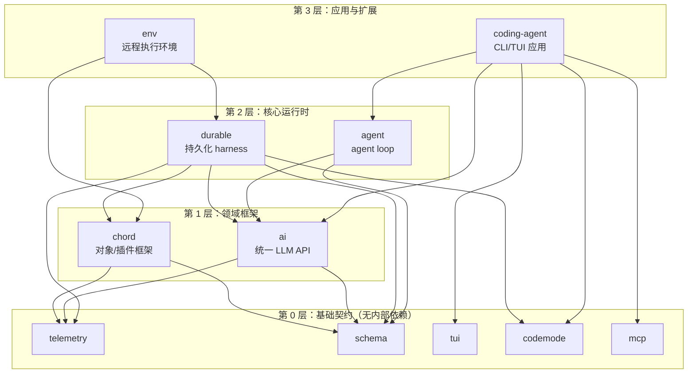
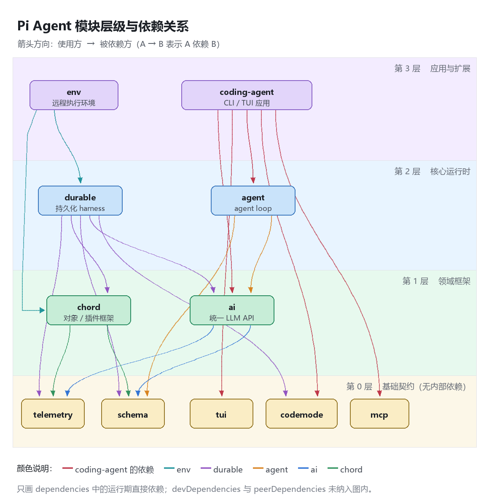

# 实践课2：组织建仓与 Pi Agent 源码分析

- 姓名：喻权（yuquan）
- 角色：组员
- 小组组织：SAD-OpenStudy
- 小组代码仓库：https://github.com/SAD-OpenStudy/pi-hunnu-2026
- 个人作业仓库：https://github.com/yuquan66611/pi-agent
- 本人重点分析的模块：`packages/ai`、`packages/coding-agent`（构建链主干），并交叉核对 `packages/agent`、`packages/durable`

说明：小组组织仓库由组长 fork 建立，我作为组员只从组织仓库克隆源码、阅读分析并在自己的个人仓库提交报告，没有在组织仓库上做构建产物或改动。

## 一、源码获取

实际使用的克隆地址（小组组织仓库）：

```
git clone --branch main https://github.com/SAD-OpenStudy/pi-hunnu-2026.git
```

克隆后执行的版本确认命令与结果：

| 检查项 | 命令 | 结果 |
|---|---|---|
| 当前目录 | `Get-Location` | `C:\dev\pi-hunnu-2026` |
| 远端地址 | `git remote -v` | `origin https://github.com/SAD-OpenStudy/pi-hunnu-2026.git`（fetch/push） |
| 当前分支 | `git branch --show-current` | `main` |
| 完整提交编号 | `git rev-parse HEAD` | `c3cc91632d0a1950fb122605b190233f2aa0006e` |
| 工作区状态 | `git status --short` | 无输出（干净，未修改） |

**截图 S1：当前目录、远端地址、分支与提交编号**



**截图 S2：下载后的源码目录**



`origin` 指向的是小组组织仓库而不是个人 fork，分支为 `main`，提交号与小组仓库当前 HEAD 一致，说明本地代码就是小组组织仓库的源码。

**截图 S3：各模块 `src` 下的 `.ts` 文件数量**（先按规模粗略判断每个包的分量，再逐个读代码）



从规模就能看出重心：`chord`（299）、`coding-agent`（265）、`ai`（211）是三个大包，`telemetry`（8）、`env`（9）、`agent`（6）是很薄的基础库——后者的“薄”不是不重要，而是职责单一、接口小。

## 二、模块分析

### 2.1 构建顺序

根目录 `package.json` 的 `build` 脚本把构建顺序写死在命令串里（`package.json` 第 15 行）：

```
cd packages/telemetry && npm run build
cd ../schema       && npm run build
cd ../chord        && npm run build
cd ../tui          && npm run build
cd ../codemode     && npm run build
cd ../mcp          && npm run build
cd ../ai           && npm run build
cd ../durable      && npm run build
cd ../env          && npm run build
cd ../agent        && npm run build
cd ../coding-agent && npm run build
```

共 11 步，串行执行；任何一步失败，后面的模块都不会构建。另有 `build:offline` 变体，唯一区别是把 `../ai` 换成 `npm run build:offline`，跳过需要联网重新生成模型目录的那一步。

### 2.2 模块分析表

| 子文件夹 | 代码主要实现什么功能 | 本模块 build 执行什么、生成什么 | 直接依赖哪些内部模块 | 依据文件或代码位置 |
|---|---|---|---|---|
| `telemetry` | 与后端厂商无关的遥测契约：回调式 `TelemetryContext`/`TelemetrySpan`、`NOOP_TELEMETRY_CONTEXT`、跨进程传播与 span link、counter/up-down counter/histogram 与类型化指标 schema，外加 `InMemoryTelemetryContext` 参考实现和 testing 子入口。刻意不带 exporter，也不维护全局 current-span。 | `tsc -p tsconfig.build.json`，只做类型检查加编译。产物 `dist/index.js`、`dist/index.d.ts`、`dist/render.*`、`dist/testing/*`，并带 declarationMap/sourceMap。无代码生成步骤。 | 无（`src/` 下 0 条 `@earendil-works/*` 跨包 import） | `packages/telemetry/package.json`（`scripts.build`）、`tsconfig.build.json`（无 `paths`）、`README.md`、`src/index.ts` |
| `schema` | 不依赖 `eval` 的 JSON Schema 构建器与校验器：schema 编译一次成为普通闭包，校验速度接近代码生成式校验器；支持 2020-12 与 draft-7，错误按 JSON Pointer 报告，带类型推导的 builders（`obj`/`str`/`int`/`oneOf`/`opt`）。`formats` 是可选的独立入口。 | `tsc -p tsconfig.build.json`。产物 `dist/index.js`、`dist/formats/*`、对应 `.d.ts`。ajv、zod、typebox、ata-validator 只出现在 `devDependencies`，用于测试对比，不进构建产物。 | 无 | `packages/schema/package.json`（`exports`、`devDependencies`）、`tsconfig.build.json`、`README.md`、`src/compiler.ts`、`src/validator.ts`、`src/builders.ts` |
| `chord` | 把应用拆成“活在多个进程里的对象 + facet 插件”的框架：对象类型用 JSON Schema 描述的契约表达，外部只拿引用（reference）；文档（documents）以事务持久化，另有 derives、jobs、principal、按主机逐个 rollout 的热重载。还提供 `http`/`workers`/`plugins`/`app`/`web`/`react`/`tui`/`sqlite`/`sync` 等大量子路径入口。 | `tsc -p tsconfig.build.json`，只做编译，产出与 `exports` 一一对应的多子路径 `dist`。本模块**不**负责把插件打成 bundle：插件的 esbuild 打包发生在 `buildFacet` 运行时（`src/node/plugins/`）。esbuild/react/ws 是 `peerDependencies`，构建期不拉进来。 | `pi-schema`（7 处 import，契约用它的 builders）、`pi-telemetry`（27 处） | `packages/chord/package.json`（`dependencies`/`peerDependencies`/`exports`）、`tsconfig.build.json`、`README.md` 的 Entry points 表、`src/contracts/`、`src/telemetry.ts`、`src/node/plugins/` |
| `tui` | 终端 UI 框架：主屏/备用屏两套渲染器、差分渲染、CSI 2026 同步输出、组件库（Editor、Markdown、SelectList、SettingsList、Image 等）、Kitty/iTerm2 内联图片、路径与斜杠命令补全。`native/` 下还有剪贴板等平台原生模块。 | `tsc -p tsconfig.build.json`，产物 `dist/index.js` + `dist/components/*`。原生模块**不在** `npm run build` 里，由独立的 `build:native:darwin` / `build:native:linux` / `build:native:win32` 脚本用 cc / xcodebuild / node 脚本编译成 `.node`，仓库里同时带有 `native/*/prebuilds` 预编译产物。 | 无内部依赖；外部依赖 `get-east-asian-width`、`marked`、`marked-cjk-friendly` | `packages/tui/package.json`（`scripts`）、`tsconfig.build.json`、`README.md`、`native/linux/build.sh`、`native/win32/build.mjs` |
| `codemode` | 在 QuickJS（编译成 WASM）沙箱里运行模型自己写的 JavaScript，脚本唯一能力是调用注入的 tools；嵌套工具调用的中间结果不进 LLM 上下文，只有最终返回值进上下文。Node 下每次执行起一个 worker 线程，Cloudflare 下用 Durable Object。 | `tsc -p tsconfig.build.json`。`tsconfig.build.json` 用 `files` 额外引入 `src/cloudflare-modules.d.ts`（`exclude` 对 `files` 不生效），让 `cloudflare:` 模块声明能通过编译。产物 `dist/index.js`、`dist/portable.js`、`dist/runtime/worker.js` 等。 | 无（README 明确 “It has no pi dependencies”） | `packages/codemode/package.json`、`tsconfig.build.json`（`files` 字段）、`README.md`、`src/wasm.ts`、`src/portable.ts` |
| `mcp` | 一个不依赖官方 MCP SDK 的独立 Model Context Protocol 客户端：传输无关的 client core、stdio / Streamable HTTP / 管道 stdio / 内存测试四种 transport、OAuth、输入 schema 归一化、输出长度限制。 | `tsc -p tsconfig.build.json`，产物 `dist/index.js`、`dist/oauth/*`、`dist/testing/*`。 | 无内部依赖；外部仅 `cross-spawn` | `packages/mcp/package.json`、`tsconfig.build.json`、`README.md`、`src/transports/`、`src/protocol/` |
| `ai` | 统一 LLM API：provider 集合与模型目录、自动鉴权解析、token 与成本统计、会话上下文持久化与中途换模型的 hand-off；内置 Anthropic / OpenAI / Google GenAI / Bedrock 等 provider 与 api 适配层。 | `build` = `npm run generate-models && npm run build:offline`。`generate-models` 跑 `node catalog/generate.ts --strict`，重新生成 `src/models.generated.ts` 与 `src/providers/data/*.json`（模型目录数据）；`build:offline` = `check:model-data` 校验 + `tsc` + 清空 `dist/providers/data` + 把 JSON 数据复制进 `dist/providers`。产物：`dist` 下的 JS/`.d.ts`、`dist/providers/data`、`bin` 入口 `dist/cli.js`（`pi-ai`）。 | `pi-schema`（6 处，工具参数与模型相关 schema）、`pi-telemetry`（2 处） | `packages/ai/package.json`（`scripts.build`/`build:offline`/`generate-models`）、`tsconfig.build.json`、`catalog/generate.ts`（第 175、245、262 行写出 `src/models.generated.ts` 与 `src/providers/data/`）、`src/providers/`、`src/api/` |
| `durable` | 可持久化的 agent harness（实验性）：会话、模型轮次、工具调用在展示之前先落盘，进程中途死掉重开存储即可续跑，死在模型请求上算失败重试。基于 `pi-ai` 取模型、`chord` 存文档状态；自带 storage（memory / jsonl / sqlite / indexeddb / store）、tools、tool-search、images、env 抽象。 | `tsc -p tsconfig.build.json`。`tsconfig.build.json` 用 `paths` 把 chord、ai 指到兄弟包 `dist`，并用 `files` 引入 `src/images/photon-wasm.d.ts` 环境声明。产物为多子路径 `dist`（`storage/*`、`tools`、`images/*`、`codemode` 等）。 | `chord`（134 处）、`ai`（28 处）、`schema`（11 处）、`telemetry`（8 处）、`codemode`（7 处） | `packages/durable/package.json`（`dependencies`）、`tsconfig.build.json`（`paths`+`files`）、`README.md`、`src/storage/`、`src/session/` |
| `env` | 给 `durable` 用的远程执行环境：`daemon/` 是一个跑在远端的 Rust 小程序，用 stdin/stdout 的分帧协议执行文件操作与命令；`RemoteExecutionEnv` 通过 SSH `Connection` 与 daemon 通信，含 host key 扫描/接受与按 SHA-256 校验部署。 | `npm run build` 只有 `tsc -p tsconfig.build.json`。Rust daemon 需要单独 `npm run build:daemon`（`cargo build --manifest-path daemon/Cargo.toml --locked`），**不在**根 `npm run build` 链里，所以根构建不会要求本机装 Rust。 | `durable`（5 处）、`chord`（3 处，用 `chord/context`） | `packages/env/package.json`（`scripts.build`/`build:daemon`）、`tsconfig.build.json`（`paths`）、`README.md`、`src/remote-env.ts`、`src/ssh.ts`、`daemon/` |
| `agent` | 有状态 agent 核心：`agent-loop` 把模型流转换成“工具调用 → 执行 → 回灌 → 继续”的循环，`agent` 负责状态与事件流，另有 proxy/stream-fn。基于 `pi-ai`。 | `tsc -p tsconfig.build.json`。`paths` 把 `pi-ai` 指到 `../ai/dist/index.d.ts`。产物 `dist/index.js` + `dist/index.d.ts`（以及 `agent-loop`、`agent`、`types` 等），没有资源拷贝步骤。 | `ai`（4 处）、`schema`（1 处） | `packages/agent/package.json`、`tsconfig.build.json`（`paths`）、`README.md`、`src/agent-loop.ts`、`src/agent.ts` |
| `coding-agent` | 面向用户的应用层：交互式 TUI、print/JSON 模式、RPC 模式、TypeScript SDK；内置工具（read/write/bash 等）、extensions / skills / prompt templates / themes、会话与迁移、图片处理、MCP 接入、codemode 工具，最后打包成可执行 CLI。 | `build` = `build:unbundled` + `node ../../scripts/build-coding-agent-bundle.mjs`。`build:unbundled` = `tsc` + `package-files executable`（给 `dist/cli.js`、`dist/rpc-entry.js` 加可执行位）+ `copy-assets`（主题 json、assets png、`export-html` 的模板与 vendor）。随后 esbuild 做：主包（`cli-runtime`/`index`/`rpc-entry` + 分块 chunks）、各 OAuth 流程与 Bedrock/图片缩放 worker 的懒加载入口、`codemode-worker`，生成 `dist/bundle/cli.js` 启动器并 `chmod 0755`，同时校验剩余外部依赖只剩允许清单。产物：`dist` 未打包代码 + `dist/bundle` 打包产物。 | `tui`（94 处）、`ai`（91 处）、`agent-core`（31 处）、`mcp`（12 处）、`codemode`（5 处）；`schema`、`telemetry` 经 `ai` 间接进入 | `packages/coding-agent/package.json`（`scripts.build`/`build:unbundled`/`copy-assets`）、`tsconfig.build.json`（`paths`）、`scripts/build-coding-agent-bundle.mjs`、`src/cli.ts`、`src/modes/`、`src/core/` |

与表中清单的差异（以实际代码为准）：

- `packages/` 下实际有 12 个目录，比作业表格多一个 `evals`。它是 `private: true` 的评测包，脚本只有 `eval`/`test`，根 `build` 链里没有它，所以不影响构建分析。
- 顶层还有 `apps/p2`、`apps/p2-mac`、`apps/p3` 三个示例应用，也不是 `npm run build` 的一环。
- 表中 11 个模块与作业要求完全对应，没有缺失。

**截图 S4：重点分析的 `ai`、`coding-agent` 的 `src` 目录**



### 2.3 模块层级与依赖关系图

箭头方向统一为“使用方 → 被依赖方”，即 A → B 表示 A 的 `package.json`/源码依赖 B。





图源：[diagram-dependencies.mmd](diagram-dependencies.mmd)（Mermaid，可直接编辑或粘到 Mermaid Live Editor）

**层级划分依据**：按“被谁依赖”的最长链分层，而不是按目录顺序。

- 第 0 层是叶子契约：`telemetry`、`schema` 是被最多模块引用的两件基础设施，`tui`、`codemode`、`mcp` 也各自没有任何内部依赖，可独立单测、独立发布。
- 第 1 层是被第 0 层喂饱的领域框架：`chord` 用 schema 描述契约、用 telemetry 打点；`ai` 用 schema 约束工具参数、用 telemetry 记录请求。
- 第 2 层是运行时：`agent` 在 `ai` 之上做循环；`durable` 在 `chord`（文档状态）+ `ai`（模型）+ `codemode`（脚本执行）之上做持久化会话。
- 第 3 层是应用与扩展：`env` 把 `durable` 的执行面挪到远端；`coding-agent` 是最终交付给用户的程序。

**关于开发依赖与可选依赖**：上面的图只画 `dependencies` 里声明的运行期直接依赖，`devDependencies`（各包的 vitest、`@types/*`；`schema` 的 ajv/zod/typebox；`ai` 的 canvas）和 `peerDependencies`（`chord` 的 esbuild/react/ws）都没有画进来。这些依赖只影响测试和特定运行形态，不进构建产物，所以不构成构建顺序约束。`coding-agent` 还把 `@silvia-odwyer/photon-node`、`jiti` 等作为 bundle 外部依赖保留（`scripts/build-coding-agent-bundle.mjs` 的 `allowedExternalPackages`）。

### 2.4 三个问题

**问题 1：根目录与子模块中的 `npm run build` 分别读取什么配置、执行什么工作？**

根目录的 `npm run build` 读的是根 `package.json` 里的 `build` 脚本，它自己不编译任何东西，只是一串 `cd packages/X && npm run build` 的串行调度。根 `package.json` 的 `workspaces` 字段（`packages/*`、`apps/*` 及几个示例目录）保证 npm 把各子包软链到 `node_modules/@earendil-works/*`，让子包之间能按包名互相 import。根 `tsconfig.json` 在这里**不参与**构建：它带 `noEmit`，`paths` 指向各包的 `src`，是 `npm run check` 里 `tsc --noEmit` 做全仓类型检查用的；真正的产物编译由各包自己的 `tsconfig.build.json` 负责。

子模块的 `npm run build` 读两样东西：本包的 `package.json`（`build` 脚本）和本包的 `tsconfig.build.json`。后者 `extends ../../tsconfig.base.json`，继承 `target ES2024`、`module Node16`、`strict`、`declaration` + `declarationMap` + `sourceMap`、`rewriteRelativeImportExtensions`（源码写 `.ts` 后缀也能编译成 `.js` 后缀的引用），再补上 `outDir: ./dist`、`rootDir: ./src`。执行工作基本都是 `tsc -p tsconfig.build.json`：把 `src/**/*.ts` 编译成 `dist` 下的 `.js` + `.d.ts` + `.map`。

关键在 `paths`：`agent`、`coding-agent`、`durable`、`env` 的 `tsconfig.build.json` 把内部依赖映射到 `../<包名>/dist/index.d.ts` 这样的**已构建产物**上，例如 `coding-agent` 有

```
"@earendil-works/pi-agent-core": ["../agent/dist/index.d.ts"],
"@earendil-works/pi-ai":         ["../ai/dist/index.d.ts"],
"@earendil-works/pi-tui":        ["../tui/dist/index.d.ts"],
```

所以子模块构建的前提是被依赖的兄弟包**已经 build 过**，这是顺序存在的根本原因。

三个子模块的 build 不是纯 `tsc`，需要单独说明：

1. `ai` 的 `build` 先跑 `generate-models`（`node catalog/generate.ts --strict`），按 `catalog/providers`、`catalog/families` 等源数据重新生成 `src/models.generated.ts` 和 `src/providers/data/*.json`；然后 `build:offline` 做数据校验、`tsc`，并把 JSON 数据从 `src/providers/data` 复制进 `dist/providers`。这一步需要联网/依赖源数据，是 `build:offline` 变体存在的原因。
2. `coding-agent` 是 `tsc` → 加可执行位 → 拷主题与 HTML 导出模板 → esbuild 打包四连：主包带 `splitting` 出 chunks，OAuth 各流程和 Bedrock 各自出懒加载入口，`codemode-worker` 单独出一个只能 import Node 内置模块的文件，最后写一个启用 `enableCompileCache` 的 `dist/bundle/cli.js` 启动器。
3. `tui` 的原生模块（`native/*/src/*.c`、`.m`）和 `env` 的 Rust daemon 都**不在** `npm run build` 里，分别走 `build:native:*` 和 `build:daemon`，属于可选步骤，所以普通构建不需要 C 编译器或 cargo。

**问题 2：构建顺序和模块依赖有什么关系？相邻构建的模块是否一定互相依赖？**

构建顺序是直接依赖关系的一张拓扑排序：被依赖者一定排在依赖者之前。这不是编码习惯，而是编译期的硬约束——后建的包要通过 `paths` 去读先建包的 `dist/*.d.ts`，如果先建包没构建过，`tsc` 直接报找不到模块。

但“相邻”不等于“互相依赖”。把根脚本里 10 对相邻关系逐一核对：

| 相邻对 | 是否依赖 | 说明 |
|---|---|---|
| telemetry → schema | 否 | 两个独立叶子包，谁先都一样 |
| schema → chord | **是** | chord 用 schema 的 builders 描述契约 |
| chord → tui | 否 | tui 无内部依赖，只因为后面 coding-agent 要用它 |
| tui → codemode | 否 | 互不相关 |
| codemode → mcp | 否 | 互不相关 |
| mcp → ai | 否 | ai 不依赖 mcp |
| ai → durable | **是** | durable 依赖 ai 取模型 |
| durable → env | **是** | env 依赖 durable 的执行环境抽象 |
| env → agent | 否 | agent 只依赖 ai/schema，env 只是排在它前面 |
| agent → coding-agent | **是** | coding-agent 依赖 agent-core |

10 对里只有 4 对真的存在依赖。也就是说，这条顺序是“所有依赖都满足”的一个**线性化超集**：它保证正确，但并不等价于依赖链。这样安排的好处是简单、确定、失败点单一（第一个报错的模块就是根因所在）；代价是模块增减或依赖变化时必须手改根 `package.json` 里那条 11 段的 `cd` 命令，而且全程串行，没有利用并行（`npm run clean`、`npm test` 用的都是 `--workspaces`，是按工作区并行/批量展开的，只有 build 被特意写成了线性链）。

**问题 3：选择一条涉及至少三个模块的依赖路径，说明这些模块如何分工。**

选主干路径：`coding-agent → agent(agent-core) → ai → schema`（另外 `ai → telemetry` 挂在旁边）。这条链是“用户敲一条命令到模型返回一次工具调用”的实际数据流：

1. **`schema`（协议层）**：提供 JSON Schema 的 builders 与编译器，把“工具参数长什么样”写成可校验的契约。`ai` 用它生成发给各家的 tools 定义，`agent` 用编译后的闭包校验模型返回的参数——一个字段名写错、类型不对，就在进入工具执行前被拒绝。
2. **`telemetry`（观测层）**：只提供 `TelemetryContext`/`TelemetrySpan` 契约和指标类型，`ai` 在请求前后打 span、记 token 与成本；因为它不带 exporter，接 OpenTelemetry 还是接日志由应用自己决定，核心包不被绑定到某个后端。
3. **`ai`（模型通信层）**：provider 适配 + 模型目录 + 鉴权解析。它把统一的消息/工具格式翻译成 Anthropic、OpenAI、Bedrock 各自协议，发流式请求，再把增量解析回统一事件；工具定义怎么转成 provider 的 `tools` 字段也在这里。
4. **`agent`（循环层）**：`agent-loop` 消费 `ai` 的流，识别 tool call → 执行工具 → 把结果作为新一轮消息回灌 → 继续直到模型不再请求工具，同时把过程以事件流抛给上层。它不关心具体模型是谁，只关心“流里有没有工具调用”。
5. **`coding-agent`（应用层）**：把上面四层组装成人能用的东西——TUI/CLI/RPC 入口、具体工具实现（read/write/bash）、extensions 与 skills、会话与迁移、以及最终 esbuild 打包。它对 `tui` 的 94 处 import 全部用于渲染，对 `ai` 的 91 处用于模型与工具编排。

一句话概括分工：`schema` 定协议，`telemetry` 管观测，`ai` 管怎么和模型说话，`agent` 管“说话—调工具—再说话”的循环，`coding-agent` 管界面和具体能力。

另一条值得对照的路径是持久化链 `durable → chord → schema/telemetry`：`durable` 对 `chord` 有 134 处 import，把会话、工具调用、文档状态都落到 chord 的 store 与事务里，这才有“进程死掉还能续跑”的语义；`env` 再在 `durable` 之上把执行面搬到远端（Rust daemon + SSH）。这条链和主干链在 `durable` 处汇合，说明 `durable` 是两条链的交叉点。

## 三、构建实测

为了验证上面的分析，我在克隆下来的小组仓库里实际跑了一遍构建。环境：Windows，Node v22.23.2 / npm 10.9.8，仓库在 `C:\dev\pi-hunnu-2026`。

**第 1 步，装依赖。** `npm ci` 失败，卡在 `canvas` 的 node-gyp 编译（本机没有 Visual Studio 构建工具）。改用仓库 README 里提到的“不需要依赖生命周期脚本”的方式：

```
npm install --ignore-scripts --no-audit --no-fund
→ added 334 packages in 55s
```

**第 2 步，跑根目录 `npm run build`。** 前 6 个模块全部通过，从 `telemetry` 到 `mcp` 一共约 15 秒；第 7 个 `ai` 停在 `generate-models` 的 `Fetching models.dev catalog...` 之后再无输出，最终没完成。

| 模块 | dist 是否生成 | `.js` 文件数 | 完成时刻 |
|---|---|---|---|
| telemetry | 是 | 8 | 15:13:47 |
| schema | 是 | 43 | 15:13:48 |
| chord | 是 | 299 | 15:13:52 |
| tui | 是 | 46 | 15:13:59 |
| codemode | 是 | 16 | 15:14:01 |
| mcp | 是 | 28 | 15:14:02 |
| ai 及其后 | 否 | — | 中断 |

**第 3 步，查明 `ai` 卡在哪。** `packages/ai/src/providers/data/` 这个目录被 `.gitignore` 显式忽略（`.gitignore` 第 11 行 `packages/ai/src/providers/data/`），新克隆的仓库里根本没有这些 JSON。`generate-models` 和 `hydrate:model-data` 都要联网从 `https://models.dev/experimental/v2.0/api.json` 拉数据后生成它；本机访问该接口时响应头正常返回 200、但响应体一直读不完，于是两步都挂住。跳过生成直接 `npm run build:offline` 也不会通过，因为里头还有一道数据校验：

```
amazon-bedrock.json is not valid JSON: ENOENT: no such file or directory, open '...\packages\ai\src\providers\data\amazon-bedrock.json'
Model data is missing or stale. Run `npm run hydrate:model-data` from the repository root.
```这也解释了 `build` 与 `build:offline` 为什么要分成两个脚本：`build:offline` 省掉的只是“重新生成”，但数据文件仍然必须在本地存在。

**第 4 步，确认这批 JSON 是编译期依赖还是运行期资源。** 绕过数据校验，直接对 `ai` 执行 `tsc -p tsconfig.build.json`，结果是一串 TS2307：

```
src/providers/openai.models.ts(4,20): error TS2307: Cannot find module './data/openai.json' or its corresponding type declarations.
```

说明 `src/providers/*.models.ts` 是用 `import values from "./data/<provider>.json"` 把模型数据**编译进**产物的——JSON 是编译期必需输入，不只是运行期文件。

**第 5 步，验证“靠兄弟包 dist 取类型”的机制。** `ai` 的 `tsc` 虽然报错但仍然产出（`tsc` 默认 `noEmitOnError: false`）。在此基础上继续编译后面三个包：`durable`、`env`、`agent` 的 `tsc -p tsconfig.build.json` 全部 `exit 0`，说明它们 `paths` 指向 `../<包>/dist/*.d.ts` 的做法确实成立——前提就是前置包先构建过。

**第 6 步，`coding-agent` 的打包。** `tsc` 与 `copy-assets` 都通过，最后 esbuild 打包失败：

```
X [ERROR] Could not resolve "./data/.manifest.json"
    packages/ai/dist/providers/all.js:11:30
X [ERROR] Could not resolve "./data/openai.json"
```

这正是依赖关系在构建期的直接体现：`coding-agent` 的 bundle 要把 `ai` 的模型数据一起打进去，`ai` 的数据没生成，`coding-agent` 就打不出来。

实测得到的结论：前 6 个包 15 秒内串行通过，`ai` 是整条链的分水岭（唯一一个需要“联网 + 代码生成”的包），它之后的 `durable`、`env`、`agent`、`coding-agent` 全部吊在它后面。全新克隆 + 无网络的环境下无法完成全量构建，这不是配置错误，而是仓库刻意把“模型目录数据”放在构建期生成的设计。

## 四、小结

1. 这个仓库的构建系统是“手写线性链 + 每包 tsc”，没有用 `tsc -b` 的项目引用，也没有用 `--workspaces` 并行；顺序靠根 `package.json` 里的 `cd` 命令维护，脆弱但直观。
2. 真正决定顺序的是 `tsconfig.build.json` 里的 `paths` —— 它把内部依赖指向兄弟包的 `dist`，所以“先依赖后依赖者”是编译期要求，不是风格问题。
3. 包的分层很干净：`telemetry`/`schema` 是最底层契约，`chord`/`ai` 是领域框架，`agent`/`durable` 是运行时，`env`/`coding-agent` 是应用。底层包普遍刻意保持零内部依赖，这让它们可以被任意上层复用。
4. 几个包的 build 不是裸 `tsc`：`ai` 带模型目录代码生成，`coding-agent` 带资源拷贝与 esbuild 打包，`tui`/`env` 的原生构建被拆成可选脚本，避免普通构建依赖 C 编译器或 cargo。
5. 亲手跑一遍才知道的最关键一点：这条构建链的“硬断点”是 `ai` 的数据生成。`ai` 的模型 JSON 不在仓库里（被 `.gitignore` 忽略，第 11 行），全新克隆后必须联网 hydrate 才能构建；一旦 `ai` 过不去，后面 4 个包全部无法打包——`coding-agent` 的 esbuild 会直接报 `Could not resolve "./data/openai.json"`。前 6 个包 15 秒就过了，卡住的永远是第 7 个。
