# 实践课3：Pi Agent 源码安装与编译

## 基本信息

- 姓名：喻权
- GitHub 登录名：yuquan66611
- 小组组织：SAD-OpenStudy
- 小组仓库（fork 来源）：https://github.com/SAD-OpenStudy/pi-hunnu-2026
- 个人仓库（报告与截图存放）：https://github.com/yuquan66611/pi-agent
- 实验时间：2026-11-26
- 实验环境：Windows 11 + Windows PowerShell 5.1，源码目录 `C:\dev\pi-hunnu-2026`

## 一、本次完成情况一览

| 项目 | 结果 |
| --- | --- |
| Node.js | v22.23.4 |
| npm | 10.9.9 |
| Git | 2.55.0.windows.5 |
| 仓库分支 / 提交 | `main` / `c3cc91632d0a1950fb122605b190233f2aa0006e` |
| `npm install --ignore-scripts` | 成功，退出码 0，18 秒 |
| 本地构建 | 成功，`Built packages\coding-agent\dist\bundle (84 files, 9.4 MiB)`，退出码 0 |
| 构建产物入口 | `packages\coding-agent\dist\bundle\cli.js` 存在，`--version` 输出 `1.5.2` |
| 源码入口 | `.\pi-test.bat --version` 输出 `1.5.2`，并完成一次带模型回复的会话 |

关于 Node 版本：本次使用机器上已有的 **Node.js v22.23.4**。根 `package.json` 只要求 `>=22.19.0`，这一版是满足的；但安装时仍有子包（`@p3/app@0.0.1`）声明 `>=24.4.0`，触发了 `EBADENGINE` 警告 —— 正好对上作业里那句话："根项目的最低版本不代表每个工作区依赖都只要求同一个版本"。本机没有装 fnm/nvm，所以没有切到 24 LTS，而是把这个差异记录下来（见任务四）。

---

## 任务一 实验准备：检查和安装开发工具

作业原文要求逐条执行：

```powershell
node --version
npm --version
git --version
```

**S1 截图（当前环境各依赖的版本）：**

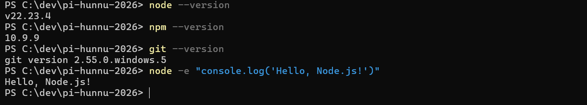

三条命令分开查，再补一条 `node -e "console.log('Hello, Node.js!')"` 确认 Node 真的能跑 JS 而不只是版本号对。

**我的理解：**

- `node --version` 查的是"当前终端能找到的那个 node"。本机 PATH 里排在前面的其实是第一次实践课装 Pi 客户端时带下来的那一份（`C:\Users\喻权\AppData\Local\pi-node\current\node.exe`），所以版本是 v22.23.4 而不是我印象里的 v22.23.2 —— 两个终端里 `node -v` 结果可能不一样，这正说明"要查当前终端的实际版本"，不能凭印象。
- `npm` 跟着 Node 一起装的，本机是 10.9.9。
- `git --version` 输出 `2.55.0.windows.5`，说明 Git for Windows 已装好，后面 clone、看提交号都靠它。

---

## 任务二 下载课程仓库源码

作业要求（第二次实践课已经做过，这里按教学过程再走一遍）：

```powershell
git clone --branch main https://github.com/hunnuOpenSourceSoftware2026/pi-hunnu-2026.git   # 换成自己小组组织内的仓库
cd pi-hunnu-2026
```

这次用的是第二次作业里克隆的小组仓库 `https://github.com/SAD-OpenStudy/pi-hunnu-2026.git`，已经在本机 `C:\dev\pi-hunnu-2026`，所以直接进去确认来源和版本：

```powershell
Get-Location
git remote -v
git branch --show-current
git rev-parse HEAD
git status --short
```

**S2 截图（当前目录、远端、分支、提交编号）：**

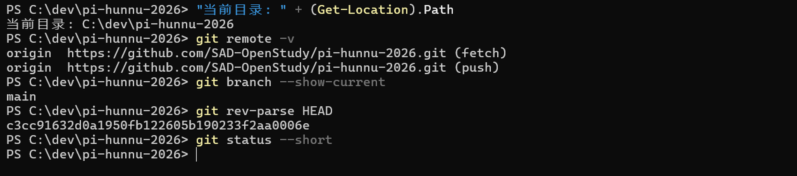

记录到的结果：

- 当前目录：`C:\dev\pi-hunnu-2026`（放在全英文路径下，避免后面构建时路径里的中文出问题）
- `origin`：`https://github.com/SAD-OpenStudy/pi-hunnu-2026.git`（fetch 和 push 都指向小组仓库）
- 分支：`main`
- 提交编号：`c3cc91632d0a1950fb122605b190233f2aa0006e`
- `git status --short` 没有任何输出，说明工作区是干净的

**我的理解：** 只打开 GitHub 网页不能证明源码下到了本地，`git remote -v` + `git rev-parse HEAD` 才能证明"我这份代码确实来自小组仓库的哪个提交"，后面构建出来的东西也是基于这个提交。

---

## 任务三 阅读配置，确认安装与编译的依据

按要求看了 `README.md`、根 `package.json`、`package-lock.json`、`packages/` 和 `packages/coding-agent/package.json`。

**S3-1 截图（根 `package.json` 的 `engines`、`workspaces` 和 `scripts.build`）：**

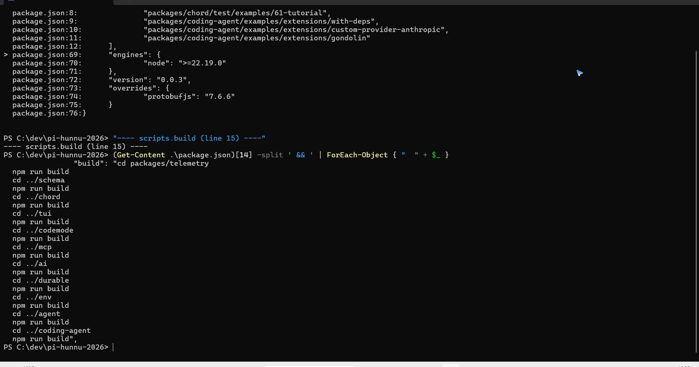

`scripts.build` 那一条太长了，为了看清楚，用 `-split ' && '` 把它按段拆开显示，可以看出是 **11 段串行的 `cd packages/xxx && npm run build`**：telemetry → schema → chord → tui → codemode → mcp → ai → durable → env → agent → coding-agent。

**S3-2 截图（`packages/coding-agent/package.json` 的 bin 与构建脚本）：**

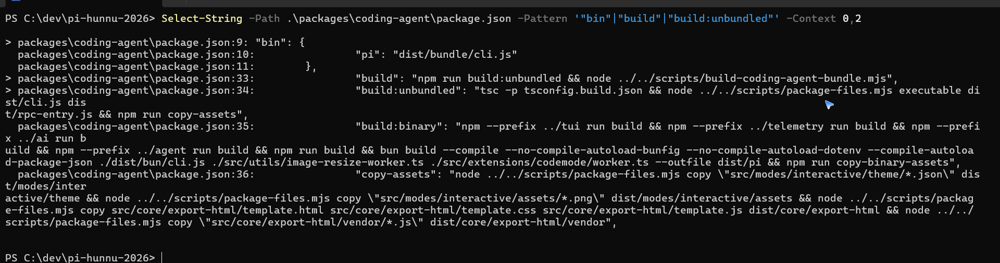

**报告回答：Node.js 版本要求在哪里？`npm run build` 实际从哪里读取命令？**

- Node 的版本要求写在**根目录 `package.json` 的 `engines.node`**（第 69–70 行），值是 `>=22.19.0`。要注意这只是根项目的"最低门槛"，各个子包和第三方依赖还会自己声明，安装时谁的要求不满足就会报 `EBADENGINE`。
- `npm run build` 读的是**根 `package.json` 里 `scripts.build` 那一行**（第 15 行）。npm 不负责编译，它只是把这条命令交给 shell 执行；这条命令先 `cd` 进各个子包，再执行子包自己的 `npm run build`，子包里的 `build` 才真正调用 `tsc`、esbuild 这些工具。以 coding-agent 为例，它的 `build` = `build:unbundled`（`tsc -p tsconfig.build.json` + 复制资源文件）再加上 `node ../../scripts/build-coding-agent-bundle.mjs`（用 esbuild 打包出 `dist/bundle/cli.js`）。`&&` 的意思是前一步成功才继续下一步，所以中途任何一个包失败，后面的包就不会跑。

**我的理解：** 这个仓库是 npm workspaces 结构，"装依赖"和"构建"都必须在根目录做一次，不能钻进子包各自装一套 —— 子包之间是互相引用的本地包，各自装会出现版本和符号链接不一致的问题。

---

## 任务四 安装项目依赖

在仓库根目录执行：

```powershell
npm install --ignore-scripts
```

**S4 截图（安装结束的输出，含警告与退出码）：**

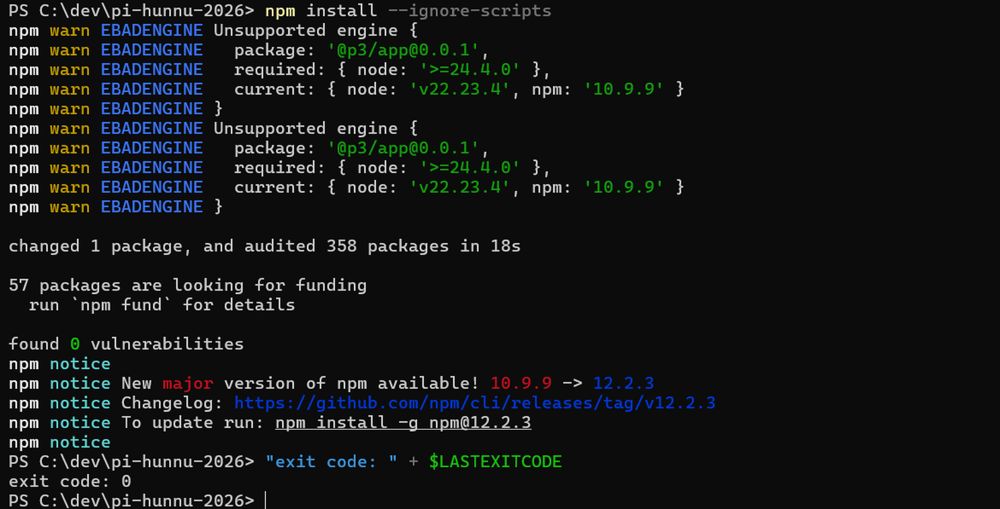

结果：`changed 1 package, and audited 358 packages in 18s`，`57 packages are looking for funding`，`found 0 vulnerabilities`，退出码 **0**。

**这条命令做了什么（按作业要求说明）：**

1. 按根 `package.json` 和 `package-lock.json` 解析依赖，锁文件一致时直接用锁定版本下载安装；
2. 在本地建 `node_modules`，同时把 workspaces 里的本地子包用符号链接关联起来（所以子包之间能直接互相 import）；
3. 装上编译要用的工具，比如 TypeScript、esbuild；
4. `--ignore-scripts` 跳过 `postinstall`、`prepare` 这类安装期自动执行的脚本 —— 它不影响后面主动跑 `npm run build`，只是不让"安装完顺手编译原生模块"这种事在安装阶段发生。

**关于警告，我是这么区分"警告"和"错误"的：**

- `EBADENGINE`：`@p3/app@0.0.1` 要求 `node >=24.4.0`，当前是 `v22.23.4`。这是**警告**，不是错误 —— 命令照样退出 0，依赖也装上了；这个包是 `apps/p3` 那个示例工作区，不参与 coding-agent 的构建。如果它导致构建失败，才需要按任务一切到 Node 24。
- `npm notice New major version of npm available! 10.9.9 -> 12.2.3`：只是提示 npm 有新大版本，和本次实验无关，不用理它。
- `found 0 vulnerabilities`：本次依赖树的审计结果，**不是**构建成功的证据，也不能像输出里建议的那样随手 `npm audit fix --force`，那会改掉课程用的依赖版本。
- 真正算"错误"的是命令以非 0 退出码结束、并且日志里出现 `npm error` 那种，比如依赖解析失败、下载 404、原生模块编译失败。这次没有出现。

---

## 任务五 本地编译与构建产物验证

### 1. 首次构建

按要求执行：

```powershell
npm run build
```

这一步会依次进入 11 个子包做编译，其中 `packages/ai` 会去 `models.dev` 拉模型目录数据再生成 `src/models.generated.ts`。我在这一步卡了很久（详见"困难与解决过程"第 3 条）：`Fetching models.dev catalog...` 之后就没有下文。

按作业提示"若提示数据缺失或过期，按错误提示补齐数据"处理之后，模型数据通过 `check:model-data` 校验（输出 `Generated model data is valid.`），然后用官方给的后续构建命令完成完整构建：

```powershell
npm run build:offline
```

`build:offline` 并不是"跳过构建"，它同样会把 11 个包全部重新编译一遍，只是复用已经准备好的模型目录数据，不再联网拉取。

### 2. 构建结果与产物验证

**S5-1 截图（构建结束的最后一段输出）：**

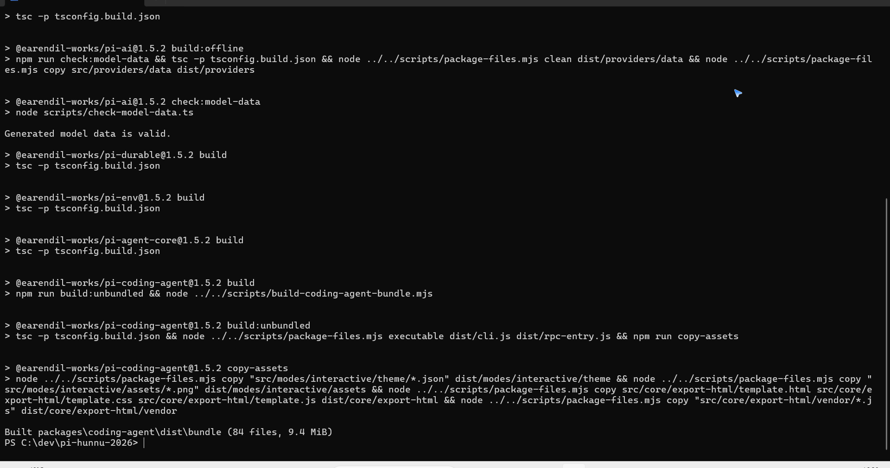

收尾是 `Built packages\coding-agent\dist\bundle (84 files, 9.4 MiB)`，说明最后一步 esbuild 打包也成功了。

**S5-2 截图（退出码、入口文件是否存在、产物版本号）：**

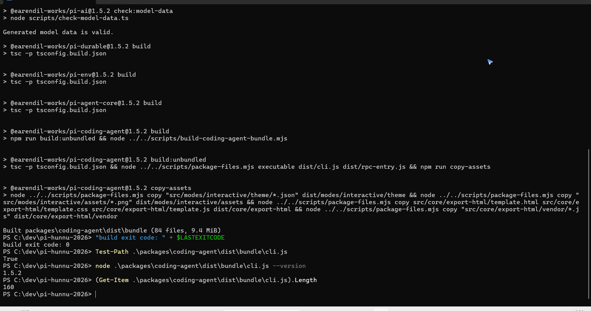

```powershell
"build exit code: " + $LASTEXITCODE        # 0
Test-Path .\packages\coding-agent\dist\bundle\cli.js   # True
node .\packages\coding-agent\dist\bundle\cli.js --version   # 1.5.2
(Get-Item .\packages\coding-agent\dist\bundle\cli.js).Length   # 160
```

**我的理解：**

- "某个子包成功"不等于"整个仓库构建成功"，必须看到最后一段输出和退出码 0；
- "有 `cli.js`"也不够，还要用这条本地路径真的把版本号跑出来（1.5.2），才能说明产物是可执行的；
- 那个 `cli.js` 只有 160 字节，因为它是个**启动器**（launcher），真正的代码被 esbuild 打在同目录的其他 bundle 文件里，它负责加载并转发参数 —— 这一点看 `packages/coding-agent/package.json` 的 `bin.pi` 指向 `dist/bundle/cli.js` 也能对上；
- 以后要改功能应该改 `src` 再重新构建，直接改 `dist` 里的文件会被下次构建覆盖。

---

## 任务六 启动本地源码版本并完成一次会话

### 1. 先验证源码入口

```powershell
.\pi-test.bat --version
```

**S6-1 截图：**

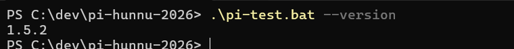

这个脚本名字带 `test`，但它不是跑测试套件，它就是"跑本地源码"的入口。为了搞清楚它到底跑了什么，把 `.bat` 和 `.ps1` 都打开看了：

**S6-2 截图（`.bat` 的内容与运行中的 node 命令行）：**

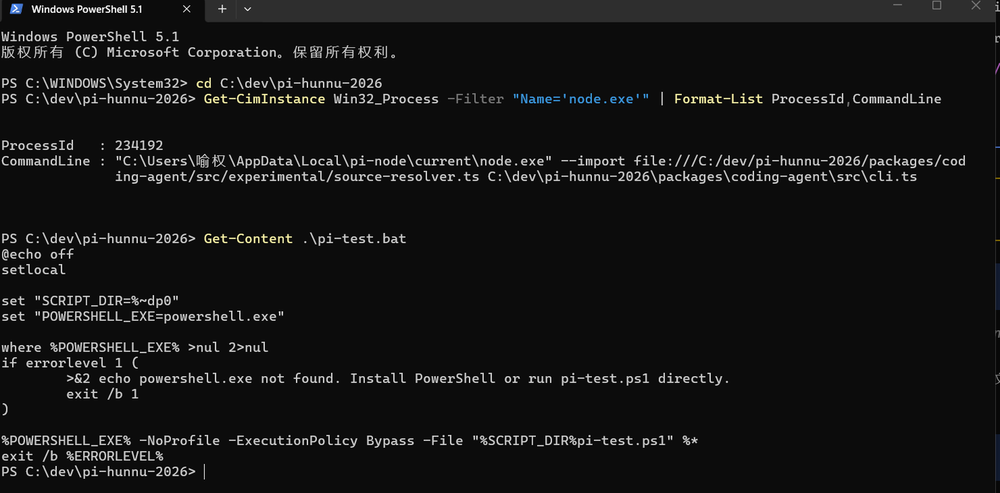

**S6-3 截图（`.ps1` 里真正调用 node 的那几行）：**

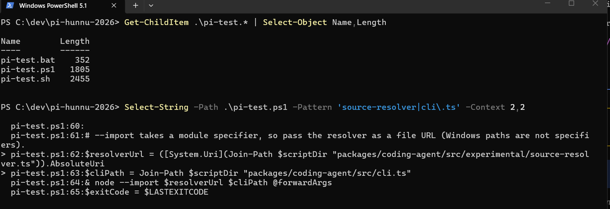

`pi-test.ps1` 第 63–64 行写得很直白：

```powershell
$cliPath = Join-Path $scriptDir "packages/coding-agent/src/cli.ts"
& node --import $resolverUrl $cliPath @forwardArgs
```

也就是用 Node 加载源码解析器（`source-resolver.ts`，让它直接吃 `.ts`），然后把 `packages/coding-agent/src/cli.ts` 当入口跑。启动 TUI 时另开一个窗口查 `node.exe` 的进程命令行，看到的确实是 `--import file:///C:/dev/pi-hunnu-2026/packages/coding-agent/src/experimental/source-resolver.ts C:\dev\pi-hunnu-2026\packages\coding-agent\src\cli.ts`。

### 2. 启动交互界面并完成一次会话

```powershell
.\pi-test.bat
```

**S6-4 截图（Pi 界面启动，底部状态栏显示的是本地仓库路径和分支）：**

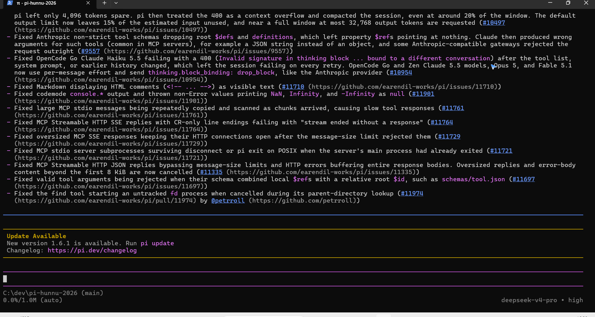

第一次启动会问是否信任该项目目录，选 `Trust` 之后进入主界面；底部状态栏显示 `C:\dev\pi-hunnu-2026 (main)`、模型 `deepseek-v4-pro • high`。由于第一次实践课已经登录过，`~/.pi/agent` 里的凭据还在，所以不需要重新 `/login`（这里复用的是用户配置，不代表跑的是全局安装版本）。

我发的问题和收到的回复：

**S6-5 截图（自己的提示词 + 真实模型回复）：**

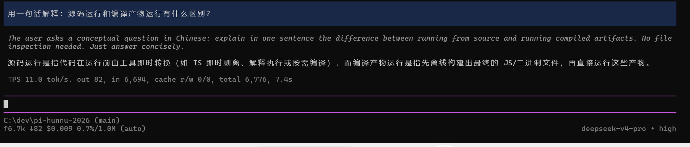

- 我的提示词：`用一句话解释：源码运行和编译产物运行有什么区别？`
- 模型回复：`源码运行是指代码在运行前由工具即时转换（如 TS 即时剥离、解释执行或按需编译），而编译产物运行是指预先离线构建出最终的 JS/二进制文件，再直接运行这些产物。`
- 会话统计：`TPS 11.0 tok/s. out 82, in 6,694 ... 7.4s`，说明这是一次真实的模型调用，不是本地假回显。

### 3. 报告说明：怎么保证跑的是本地源码？两个入口分别适合什么场景？

**（1）怎么保证跑的是本地源码**

我没直接敲 `pi`，敲的是仓库根目录的 `.\pi-test.bat`。为了确认它真跑源码，我看了 `pi-test.ps1`，它把 `packages/coding-agent/src/cli.ts` 直接丢给 node 执行（前面那个 `--import ...source-resolver.ts` 就是让它能直接吃 `.ts` 不用先编译）。另外 TUI 起来之后我又开了个终端查 `node.exe` 的命令行，里面明明白白写着 `...\pi-hunnu-2026\packages\coding-agent\src\cli.ts`；界面状态栏显示的路径也是 `C:\dev\pi-hunnu-2026 (main)`。命令、脚本内容、进程命令行、界面路径这四处能对上，就能确认跑的是我拉下来的这份源码，而不是第一次实践课装的全局版。

**（2）源码入口和 `dist/bundle/cli.js` 入口各适合什么场景**

- 源码入口（`pi-test.bat` → `src/cli.ts`）：适合自己改代码的时候用，改完直接跑，不用等编译，报错也直接指向 `src` 里的行号。代价是每次都要在仓库目录里跑、启动时多带一个解析器会稍慢一点，而且它依赖整个仓库结构和 `node_modules`，不适合发给别人。
- `dist/bundle/cli.js`：是编译好的成品，启动快、只依赖打包好的那几个文件，适合平时日常使用、给别人用、或者打包发出去。但它不会跟着源码变 —— 改了 `src` 必须重新 `npm run build`，否则跑的还是旧版本。想验证"我这次编译出来能不能用"，跑 `node .\packages\coding-agent\dist\bundle\cli.js --version` 就是最直接的检查。

---

## 七、困难与解决过程（重点）

### 1. PowerShell 里 `npm` 直接被策略拦下来

第一次在 PowerShell 里敲 `npm --version`，没出版本号，反而一片红：

> `npm : 无法加载文件 C:\Users\...\pi-node\current\npm.ps1，因为在此系统上禁止运行脚本。`

原因是 `npm` 在这个终端里解析到的是 `npm.ps1` 这个 PowerShell 脚本，而本机 `Get-ExecutionPolicy -List` 里所有作用域都是 `Undefined`（等价于默认的 Restricted），脚本一律不许跑。

**S7 截图（报错、策略列表、以及修好之后的版本号）：**

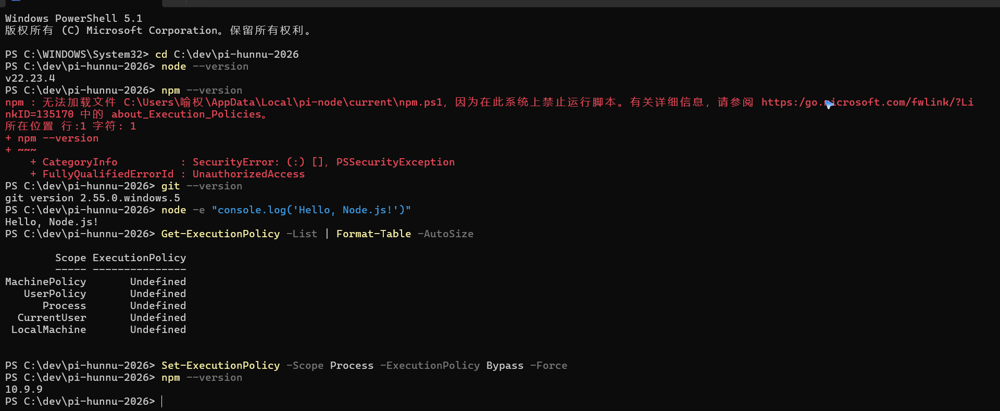

**解决：** 只在当前这个会话里放开，不改系统的全局设置：

```powershell
Set-ExecutionPolicy -Scope Process -ExecutionPolicy Bypass -Force
```

再执行 `npm --version` 就正常输出 10.9.9 了。用 `-Scope Process` 的好处是关掉窗口就恢复原样，不影响别人用这台电脑。

### 2. `npm ci` 卡在 canvas 的 node-gyp 上，改用 `--ignore-scripts`

一开始想用 `npm ci` 装（干净、快、严格按锁文件来），结果在 `canvas` 这个包上失败：它要走 `node-gyp` 编译原生模块，需要 Visual Studio 的 C++ 构建工具链，本机没装。

**解决：** 按作业和 README 给的方式改用

```powershell
npm install --ignore-scripts
```

`--ignore-scripts` 跳过了安装阶段的 `postinstall`，`canvas` 就不在安装时编译了。而后面真正需要的 TypeScript、esbuild 都是纯 JS 工具，用不上原生编译，所以对本次构建没有影响。这也说明：遇到原生模块装不上，先判断它是不是构建必需的，再决定是补工具链还是跳过脚本。

### 3. 首次 `npm run build` 卡死在拉取模型目录（最有代表性的一个坑）

`npm run build` 跑到 `packages/ai` 时停在这里不动：

```
> @earendil-works/pi-ai@1.5.2 build
> ...
Fetching models.dev catalog...
```

等 3～5 分钟没有任何新输出。单独测网络：`fetch('https://models.dev/experimental/v2.0/api.json')` 返回的是 200，但响应体一直读不完（90 秒超时）；换 `curl.exe --max-time 60` 直接连接超时。也就是说本机到 `models.dev` 这条链路时通时不通，构建脚本拿不到目录数据就不会往下走。

中间有一次是跑通的（日志同样以 `Built packages\coding-agent\dist\bundle (84 files, 9.4 MiB)` 结尾），但接着又连续卡住两次，说明这不是偶发，不能靠"再试一次"。

**解决思路：** 这一步要的只是"模型目录数据"（模型清单、能力配置这类 JSON），不是大模型权重。既然拉不下来，就用官方已发布的同版本包里的现成数据补上：

1. `npm pack "@earendil-works/pi-ai@1.5.2"` 把 npm 上同版本的包拉下来解开；
2. 把它 `dist/providers/data` 下的模型数据（44 个文件，含 `.manifest.json`）复制到仓库的 `packages/ai/src/providers/data`；
3. 跑校验命令确认数据是有效且完整的：

```powershell
npm run check:model-data
# Generated model data is valid.
```

4. 再用作业里给的后续构建命令完成完整编译：

```powershell
npm run build:offline
# ...
# Built packages\coding-agent\dist\bundle (84 files, 9.4 MiB)   （退出码 0）
```

`build:offline` 同样会把 11 个包全部重新编译，只是不再联网拉数据，所以它给出的"构建成功"是完整的，不是只编译了一个子包。

顺带记一个细节：`packages/ai/src/providers/data/` 这个目录在 `.gitignore` 里（第 11 行），所以它是"本地产物"，不会污染仓库的提交，这也解释了为什么它必须每次本地准备。

### 4. `npm install` 顺手改了 `package-lock.json`

装完之后 `git status` 里多了 `M package-lock.json`，`git diff --stat` 显示 **90 行删除**，删掉的基本是 `"libc"` 这类字段 —— 这是当前 npm 版本在写锁文件时和原锁文件元数据格式不一致造成的，跟依赖本身无关。

**解决：** 这些改动不是我要提交的内容，直接还原：

```powershell
git checkout -- package-lock.json
git status --short    # 无输出，工作区干净
```

这样仓库里只留下"源码 + 构建产物（被 gitignore 的部分）"，不会因为一次安装把锁文件带进提交。

### 5. 小结：这次实验真正学到的东西

- **"命令能跑"和"跑的是哪一份"是两件事**：`pi` 能跑不代表跑的是本地源码，`npm` 能跑也不代表跑的是我想用的那个 npm（本机就有 pi 自带的那一份排在 PATH 前面）。
- **警告要看 `required` 和 `current`**：`EBADENGINE` 只有在真的挡住构建时才需要处理，本次它来自一个示例工作区。
- **构建链条很长，出错位置要精确到"哪个包、哪一步"**：同样是"构建失败"，卡在 `Fetching models.dev catalog...` 和卡在 esbuild 打包，处理方式完全不同。
- **环境问题优先用最小代价解决**：`Set-ExecutionPolicy -Scope Process`、`--ignore-scripts`、`build:offline`，都是在不破坏系统、不改依赖版本的前提下绕过去的办法。
