# 实践课 4：Pi Agent 的模型调用与运行流程

## 基本信息

- 姓名：喻权（yuquan）
- GitHub 登录名：yuquan66611
- 小组：SAD-OpenStudy
- 个人仓库：<https://github.com/yuquan66611/pi-agent>
- 小组代码仓库：<https://github.com/SAD-OpenStudy/pi-hunnu-2026>
- 运行环境：Windows + PowerShell，Node v22.23.4，npm 10.9.9，Pi 1.5.2（实践课 3 源码编译的那个版本，仓库 commit `c3cc916`）
- 本次使用的模型：`deepseek/deepseek-v4-pro`（provider：`deepseek`）

这次的任务说白了就两件事：一是往 Agent 的主循环里塞两行日志，看它到底什么时候去喊模型；二是拿同一个模型，一个直接问、一个让它读文件，把两次的日志对着看，搞清楚"工具跑完了，结果是怎么接上下一轮的"。

## 任务一：给 Agent 循环加两行日志

### 1. 在模型调用前打印日志

打开 `packages/agent/src/agent-loop.ts`，在 `const response = await streamFunction(...)` 上方插一行。我这份代码的行号和教师演示版一致：原来是第 412 行，插入后新日志落在**第 413 行**。

```ts
console.error("[P4] Agent 即将请求模型"); // 新增
const response = await streamFunction(config.model, llmContext, {
```

**S1：编辑器中的 agent-loop.ts，能看到文件名、行号，以及新增的日志和它下面的 `await streamFunction(...)`。**

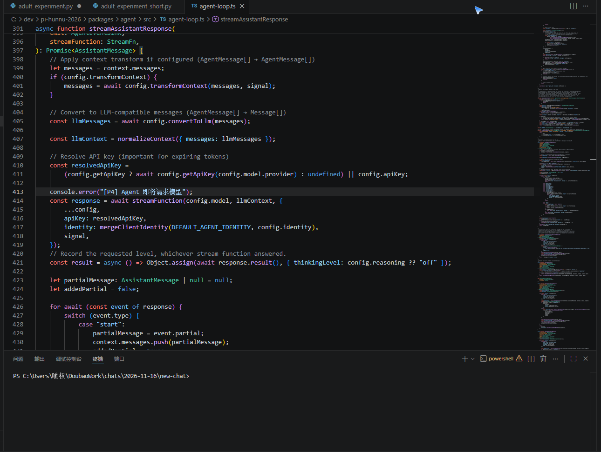

说一下我对这一行的理解。它上面的 `llmContext` 是把 `context.messages` 经过 `convertToLlm()` 转成模型能吃的格式之后拿到的，所以这行日志打出来的时候，意思是"这一轮要发给模型的东西已经打包好了，马上就要发出去"。每次看到这行，就等于一次模型请求开始了。

### 2. 在工具结果加入上下文后打印日志

再往下找 `currentContext.messages.push(result);`（原第 284 行），在它**下面**插一行，插入后是**第 285 行**，位置在 `currentContext.messages.push(result)` 和 `newMessages.push(result)` 之间：

```ts
for (const result of toolResults) {
    currentContext.messages.push(result);
    console.error("[P4] 工具结果已加入上下文"); // 新增
    newMessages.push(result);
}
```

**S2：agent-loop.ts 里的 for 循环、`currentContext.messages.push(result)`，以及紧接着新增的日志。**

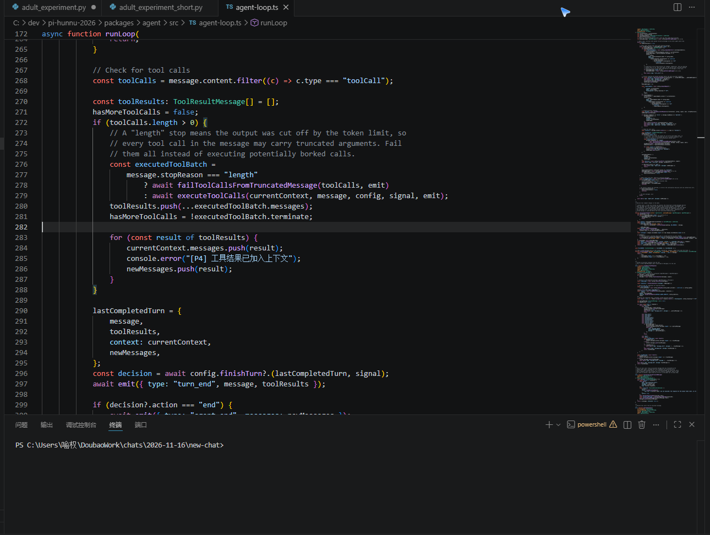

这行在 `for` 循环里面，所以一轮里调了几个工具就会打几次；而且必须写在 push 之后，不然日志就不代表"已经进上下文了"。

### 3. 完整差异

```diff
@@ -282,6 +282,7 @@ async function runLoop(

 				for (const result of toolResults) {
 					currentContext.messages.push(result);
+					console.error("[P4] 工具结果已加入上下文");
 					newMessages.push(result);
 				}
 			}
@@ -409,6 +410,7 @@ async function streamAssistantResponse(
 	const resolvedApiKey =
 		(config.getApiKey ? await config.getApiKey(config.model.provider) : undefined) || config.apiKey;

+	console.error("[P4] Agent 即将请求模型");
 	const response = await streamFunction(config.model, llmContext, {
 		...config,
 		apiKey: resolvedApiKey,
```

两行都用 `console.error` 而不是 `console.log`，原因是 stdout 要留给 Pi 自己的交互界面和 `-p` 模式的正式输出，日志走 stderr 两个流分开了，才不会把回答冲得七零八落。实测在全屏 TUI 里，这些 `[P4]` 行是显示在状态栏上方那一块的，不挡对话框。

## 任务二：重新编译并启动

### 编译（S3a、S3b）

在根目录 `npm run build`，结果卡在 `packages/ai` 生成模型目录那一步。

**S3a：`npm run build` 卡在 `Fetching models.dev catalog...` 的位置。**

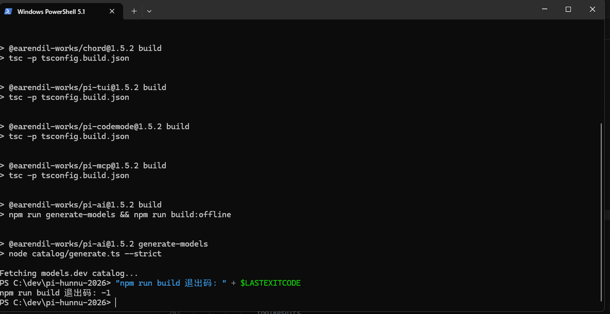

`Fetching models.dev catalog...` 打出来之后就不动了，等了三分多钟没有任何后续输出。查了一下：这一步是 `packages/ai` 的目录生成脚本要联网去 models.dev 拉模型清单，而我这边网络访问那个站特别慢（自己用 curl 试了下大概 7 KB/s，240 秒才下到 1.6 MB，续传时直接 SSL 握手失败）；脚本里也没有超时和重试，加上跑的是 `--strict`，拿不到数据就停在那儿。

所以换成仓库自带的离线构建：

```powershell
npm run build:offline
```

**S3b：离线构建跑完，`Built packages\coding-agent\dist\bundle (84 files, 9.4 MiB)`，`$LASTEXITCODE` 为 0。**

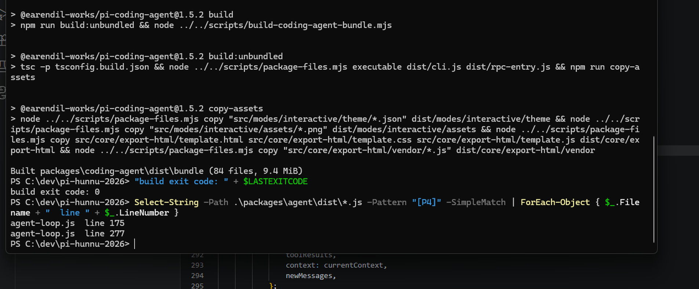

除了 ai 包跳过联网取数（直接用仓库里已有的 catalog），其它包还是按依赖顺序串行编译，编译步骤和 `npm run build` 是一样的。最后 `"build exit code: " + $LASTEXITCODE` 打出 0。

顺手还验证了一下编译产物里真的有新增日志，免得改了源码却没用上（图中最后一段）：

```powershell
Select-String -Path .\packages\agent\dist\*.js -Pattern "[P4]" -SimpleMatch | ForEach-Object { $_.Filename + " line " + $_.LineNumber }
# agent-loop.js line 175
# agent-loop.js line 277
```

### 启动（S4）

```powershell
node .\packages\coding-agent\dist\cli.js
```

**S4a：执行的命令。**

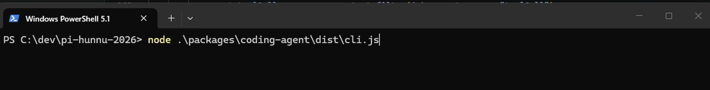

**S4b：命令跑起来后打开的 Pi 交互界面（[Context]、[Skills]、[Prompts]、[Extensions] 和底部状态栏）。**

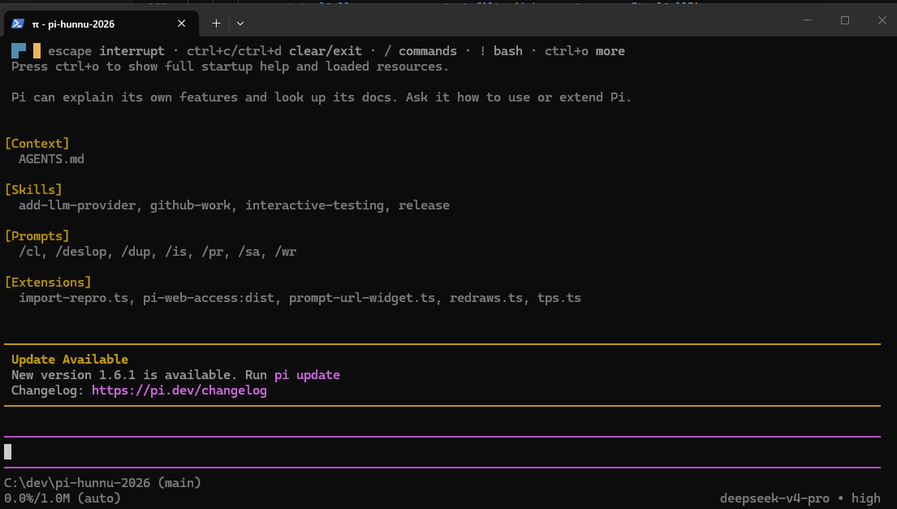

这里启动的是没打包的入口 `dist\cli.js`（不是 `dist\bundle\cli.js`），全屏 TUI 用的是这个，实践课 3 也是这么启的。退出按 `ctrl+d`（界面顶部那行提示就写着 `escape interrupt · ctrl+c/ctrl+d clear/exit`），退出后终端里 `$LASTEXITCODE` 是 0：

**S4c：正常退出后，`$LASTEXITCODE` 为 0。**

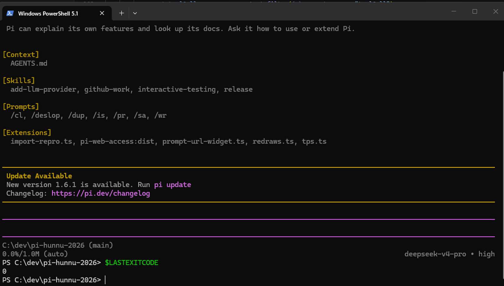

## 任务三：对比两次运行

### 准备

在项目根目录建 `practice4.txt`，写一行实验代号：

```text
YUQUAN-P4-2F7C
```

两次会话都用同一个模型（`deepseek/deepseek-v4-pro`），每次都是全新会话。为了让 `[P4]` 日志和回复能在一屏里看清，这里用的是 `-p`（print）模式；本机 `-p` 如果 stdin 是空的会一直等着不退出，所以前面加了个空串管道，这是本机的怪脾气，跟作业内容无关。

### 会话 A：直接问答

```powershell
"" | node .\packages\coding-agent\dist\cli.js --provider deepseek --model deepseek/deepseek-v4-pro -p "请直接用一句话解释什么是 Git 分支。"
```

**S5：会话 A 的输入指令、`[P4]` 日志和 Pi 的最终回复。**

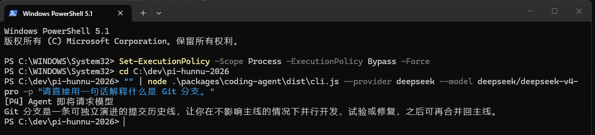

- 实际日志（1 条）：

```text
[P4] Agent 即将请求模型
```

- 没有出现"工具结果已加入上下文"，也就是说这次没调工具。
- 模型调用轮数：**1 轮**。
- 最终回复：`Git 分支是一条可独立演进的提交历史线，让你在不影响主线的情况下并行开发、试验或修复，之后再合并回主线。`

### 会话 B：读取文件

```powershell
"" | node .\packages\coding-agent\dist\cli.js --provider deepseek --model deepseek/deepseek-v4-pro -p "请用 read 工具读取当前目录的 practice4.txt，并告诉我文件中的实验代号。"
```

**S6a：会话 A、B 两次运行的完整终端记录，B 的两类日志顺序、`read` 的调用、以及带代号的回复都在里面。**

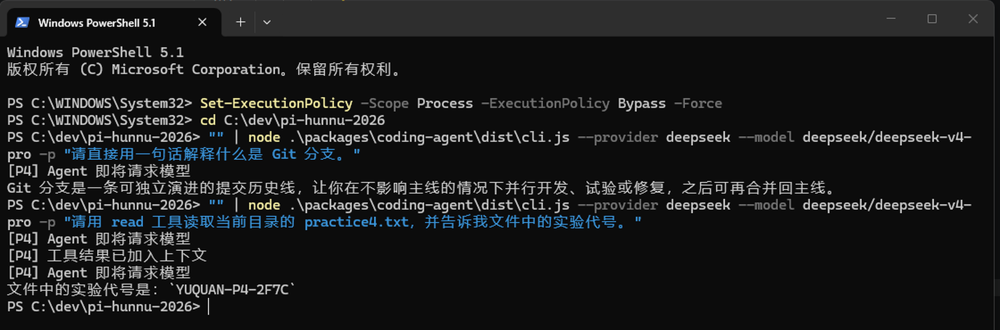

- 实际日志（按出现顺序，3 条）：

```text
[P4] Agent 即将请求模型
[P4] 工具结果已加入上下文
[P4] Agent 即将请求模型
```

- 日志条数换算：`即将请求模型` 出现 2 次 → **2 轮模型调用**；`工具结果已加入上下文` 出现 1 次 → **1 次工具结果入上下文**，也就是只读了一次文件。
- 最终回复：`文件中的实验代号是：YUQUAN-P4-2F7C`（代号和我写进文件的一致）。

**S6b：全屏 TUI 里的同一次会话 B，绿色工具卡片就是 `read` 在读 `practice4.txt`，底部是两条 `[P4]` 日志。**

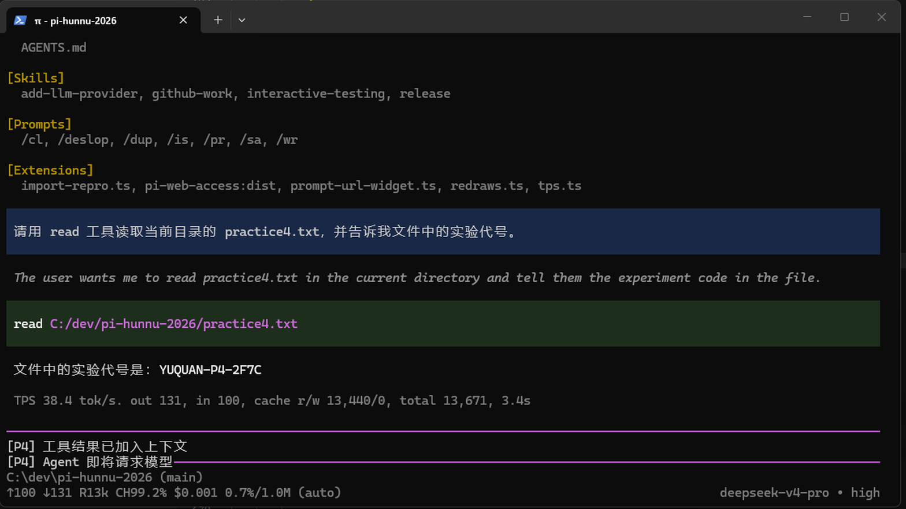

### 两次会话对照

| 项目 | A：直接问答 | B：读取文件 |
| --- | --- | --- |
| 输入指令 | 请直接用一句话解释什么是 Git 分支。 | 请用 read 工具读取当前目录的 practice4.txt，并告诉我文件中的实验代号。 |
| 是否调用工具 | 否 | 是，调用 `read` 一次 |
| `即将请求模型` 次数 | 1 | 2 |
| `工具结果已加入上下文` 次数 | 0 | 1 |
| 模型调用轮数 | 1 轮 | 2 轮 |
| 最终回复 | Git 分支是一条可独立演进的提交历史线…… | 文件中的实验代号是：YUQUAN-P4-2F7C |

### 三个问题

**谁实际读了文件？**

是 Pi 本地的 `read` 工具读的，不是模型读的。模型只做了"决定要读"这件事——它返回一个工具调用请求（工具名 `read`、参数是文件路径），然后 `agent-loop` 在本地把文件内容读出来。所以文件内容从来没进过模型那边，是先被本地工具读成文本、再塞回上下文，模型才"看见"的。S6b 里那张绿色的工具卡片，就是工具在干活的记录。

**下一轮模型请求多带了什么？**

多了一条工具结果消息，`role` 是 `toolResult`，里面有 `toolCallId`（指回上一次那个工具调用）、`toolName`（`read`）、`content`（`practice4.txt` 里那行 `YUQUAN-P4-2F7C`）。说白了就是：第二次请求的 `messages` 比第一次多了一条，模型这才知道文件里写了啥，也才能回答出代号。日志顺序也说明了这点——工具结果一 push 进上下文，循环紧接着就又开始请求模型了，所以"工具结果已加入上下文"后面紧跟的必然是"即将请求模型"。

**两次分别进入了几轮模型调用？**

A 一轮：问一句，模型直接答，没有工具介入。B 两轮：第一轮模型决定调 `read` 并给出参数，工具在本地读完把结果写进上下文，第二轮模型拿着文件内容再回答。日志条数正好对上：B 两条"即将请求模型"、一条"工具结果已加入上下文"。

### 简图：一次工具调用时各层在做什么

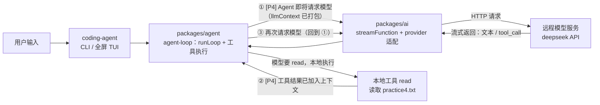

一句话串起来：`coding-agent` 负责界面和会话，`packages/agent` 的 `agent-loop` 负责"请求模型 → 判断要不要调工具 → 执行工具 → 结果写回上下文 → 再请求模型"这个循环，`packages/ai` 负责把消息转成各家 provider 的格式并真正发出 HTTP 请求，远程模型服务只负责"看消息、吐文字或吐工具调用"。文件永远是本地工具读的，模型只看到读出来的文本。

## 复现步骤

```powershell
cd C:\dev\pi-hunnu-2026
# 1. 改 packages/agent/src/agent-loop.ts，加两行 [P4] 日志
# 2. 编译（网络好的机器用 npm run build；像我这种拉不到 models.dev 的用离线构建）
npm run build:offline
# 3. 启动
node .\packages\coding-agent\dist\cli.js
# 4. 两次会话（新会话各跑一次）
"" | node .\packages\coding-agent\dist\cli.js --provider deepseek --model deepseek/deepseek-v4-pro -p "请直接用一句话解释什么是 Git 分支。"
"" | node .\packages\coding-agent\dist\cli.js --provider deepseek --model deepseek/deepseek-v4-pro -p "请用 read 工具读取当前目录的 practice4.txt，并告诉我文件中的实验代号。"
```

截图里没有出现任何 API Key 或账号授权信息。

## 小结

这两行日志其实把 Agent 的"心跳"露出来了：`即将请求模型` 是进模型的入口，`工具结果已加入上下文` 是循环后半段的回写点。一个纯问答的请求只会碰到前者一次；带工具的请求会在两者之间来回，一个工具调用就要多花一轮模型调用。以前觉得"AI 自己会读文件"，这次看日志才明白：读文件的是本地工具，模型只是拿着读出来的文本继续往下说。
