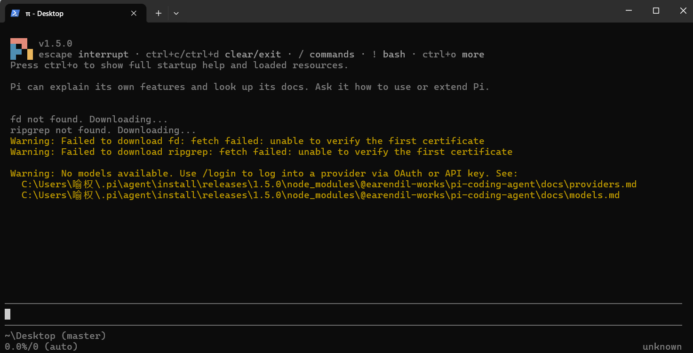
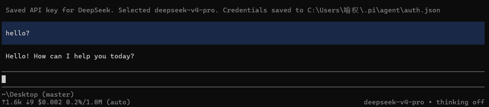
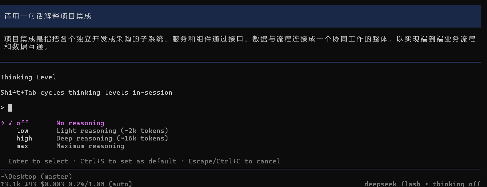
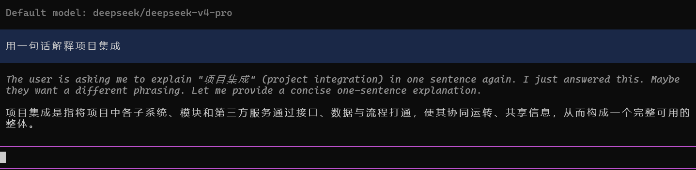
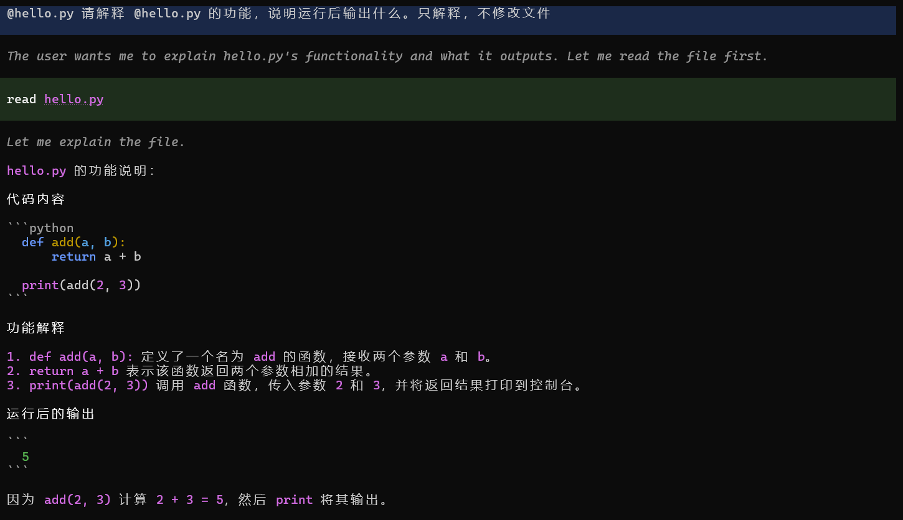
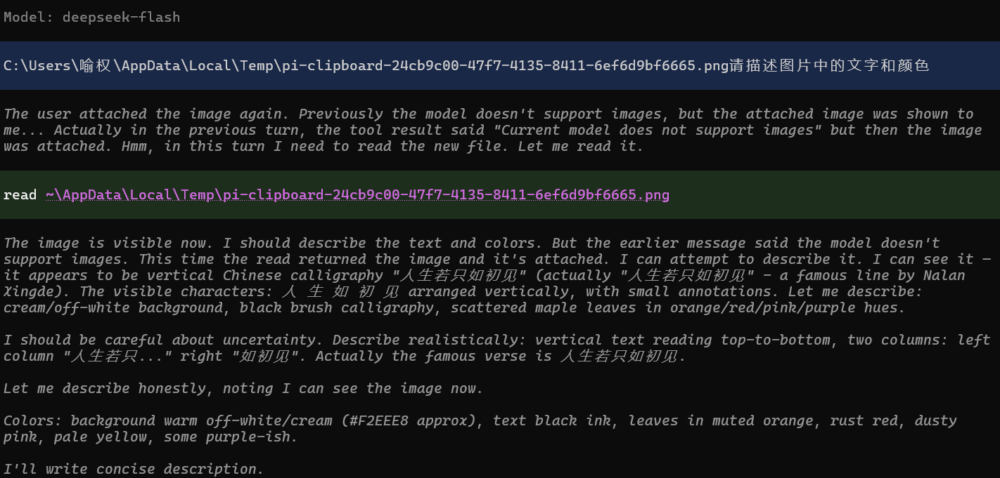
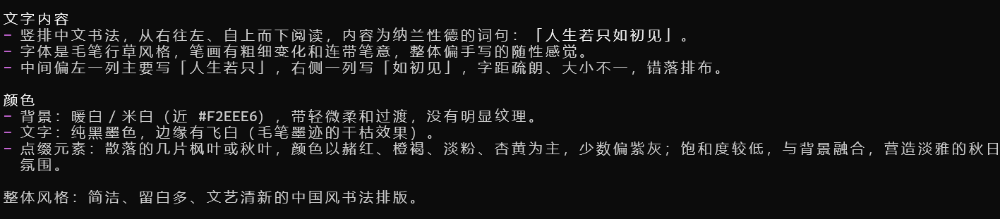
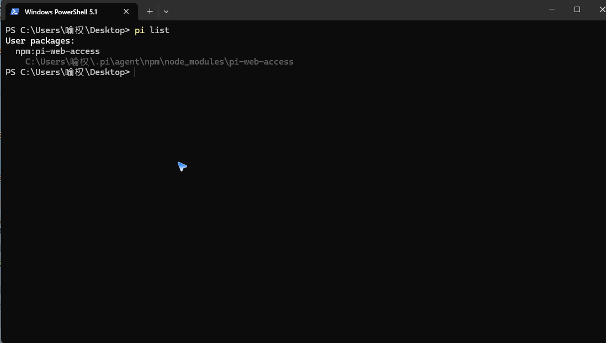

# 实践课1：Pi Agent 安装与使用 —— 个人实验报告

## 1. 基本信息

- 姓名：喻权；GitHub 登录名：`yuquan66611`
- 个人仓库地址：<https://github.com/yuquan66611/pi-agent>
- 报告入口：本文件（`report/README.md`）；全部截图位于 `report/images/`
- 实验机环境：Windows 11 + Windows PowerShell 5.1；Node.js `v22.23.2`；npm `10.9.8`；git `2.55.0.windows.5`
- Pi 客户端：`pi 1.5.0`，安装目录 `C:\Users\喻权\.pi\agent`，命令入口 `C:\Users\喻权\.pi\agent\bin\pi.cmd`
- 模型提供商：DeepSeek（默认 `deepseek-v4-pro`；另配 `deepseek-flash`，支持图片输入）
- 练习目录：任务一~三在 `C:\Users\喻权\Desktop` 启动；任务四、五的示例文件在 `C:\Users\喻权\Desktop\pi-test`；任务五安装插件后重新启动使用桌面目录

本报告中每条结论都对应可核对的截图：S1 为任务一，S2 为任务二，S3_1、S3_2 为任务三，S4 与 S5_1、S5_2（含 `S5原图.png`）为任务四，S6_1~S6_3 为任务五。任务六是选做项，本次未做。

---

## 2. 任务一：本地安装并启动（截图 S1）

按指导书给出的官方来源在 PowerShell 中执行安装器：

```powershell
powershell -c "irm https://pi.dev/install.ps1 | iex"
```

安装完成后关闭旧终端再重新打开（让新写入的 `PATH` 生效），然后在练习目录中启动：

```powershell
cd C:\Users\喻权\Desktop
pi
```



截图验收要点：

| 要求 | 截图中的证据 |
| --- | --- |
| Pi 已成功启动 | 顶部 `v1.5.0` 与状态行 `escape interrupt · ctrl+c/ctrl+d clear/exit · / commands · ! bash · ctrl+o more` |
| 版本信息 | `v1.5.0` |
| 当前工作目录 | 底部状态行 `~\Desktop (master)`（桌面目录本身是一个 Git 仓库，所以状态行带分支名） |
| 尚未配置模型的状态 | 黄色 `Warning: No models available. Use /login to log into a provider via OAuth or API key.`，并给出 `providers.md`、`models.md` 的本地文档路径 |

截图里还有两条黄色告警：`Failed to download fd: fetch failed: unable to verify the first certificate` 与 `Failed to download ripgrep`。这两项是 Pi 的可选外部搜索工具，启动时会尝试下载；本机网络下证书链不被 Node.js 默认 CA 接受，所以下载失败。它只影响 `find`/`grep` 等可选工具，不影响客户端启动、模型会话与后续任务，因此没有继续处理（详见第 9 节）。

---

## 3. 任务二：配置模型并完成一次会话（截图 S2）

在 Pi 中执行 `/login`，选择 `Sign in with an API key`，搜索并选择提供商 `DeepSeek`，粘贴在 DeepSeek API Platform 创建的密钥。提交后 Pi 提示：

```text
Saved API key for DeepSeek. Selected deepseek-v4-pro. Credentials saved to C:\Users\喻权\.pi\agent\auth.json
```

随后发送 `hello?`，模型正常回复 `Hello! How can I help you today?`，底部状态行显示 `deepseek-v4-pro · thinking off`，并给出本次用量 `↑1.6k ↓9 $0.002`。



说明：

- 密钥只保存在本机 `C:\Users\喻权\.pi\agent\auth.json`，本报告与仓库都不包含该文件，也不包含密钥原文与授权回调链接。
- 验收重点是"配置成功后能收到模型回复"，而不是密钥创建过程，因此截图从配置结果开始。

---

## 4. 任务三：切换模型与思考级别（截图 S3_1、S3_2）

### 4.1 切换模型

用 `/model` 打开模型选择器，记录当前模型 `deepseek-v4-pro`，切换到另一个可用模型 `deepseek-flash`，发送一个短问题确认仍能正常会话：

> 请用一句话解释项目集成

回复为"项目集成是指把各个独立开发或采购的子系统、服务和组件通过接口、数据与流程连接成一个协同工作的整体，以实现端到端业务流程和数据互通。"，状态行为 `deepseek-flash · thinking off`。

### 4.2 切换思考级别

用 `/thinking`（或 `Shift+Tab` 循环）打开思考级别菜单，菜单给出四档：`off`（No reasoning）、`low`（Light reasoning ~2k tokens）、`high`（Deep reasoning ~16k tokens）、`max`（Maximum reasoning），当前勾选 `off`。



切回 `deepseek-v4-pro` 并把思考级别调高后，再次发送同一类问题：

> 用一句话解释项目集成

这一次回复前先出现了一段以斜体呈现的思考内容（"The user is asking me to explain … in one sentence again. I just answered this. Maybe they want a different phrasing."），随后才是正式回答；状态行 `Default model: deepseek/deepseek-v4-pro` 说明此时已回到 v4-pro。



### 4.3 两个模型的思考档位并不相同

思考级别是模型的推理设置，不是"换模型"。本机两个模型的可用档位可以从 `C:\Users\喻权\.pi\agent\models-store.json` 的 `thinkingLevelMap` 与 `input` 字段直接看出：

| 模型 | 支持的思考档位 | 输入类型 | cost（输入/输出） |
| --- | --- | --- | --- |
| `deepseek-flash`（DeepSeek V4.1 Flash） | `low` / `high` / `max`（`minimal`、`medium` 映射为 `null`） | `text` + `image` | `0.3` / `1.2` |
| `deepseek-v4-pro` | `high` / `max`（`minimal`、`low`、`medium` 均为 `null`） | 仅 `text` | `1.32` / `3.96` |

选择依据（结合本次练习的实际需要）：

- 任务四的图片测试需要多模态输入，只有 `deepseek-flash` 声明了 `input: ["text", "image"]`，所以图片任务必须切到 flash；
- 读文件、解释代码这类短任务用 `thinking off/low` 就够，响应快；`high/max` 适合需要多步推理的复杂任务，但等待时间与 token 用量会上升（同一类短问题，S2 为 `$0.002`，S3_1 为 `$0.003`）；
- 较高思考级别不保证答案一定更好，因此日常会话不必一直开 `max`。

---

## 5. 任务四：引用代码并粘贴小图片（截图 S4、S5_1、S5_2）

### 5.1 使用 `@` 引用代码文件

在 `C:\Users\喻权\Desktop\pi-test` 下创建 `hello.py`（仓库内 `pi-test/hello.py` 与之一致）：

```python
def add(a, b):
    return a + b

print(add(2, 3))
```

在该目录启动 Pi，输入 `@`，在候选列表里选中 `hello.py`（只打出 `@` 而不选中文件不算引用），再发送：

> @hello.py 请解释 @hello.py 的功能，说明运行后输出什么。只解释，不修改文件



截图里可以依次看到：带 `@hello.py` 的提示词 → 思考段 → 工具调用块 `read hello.py` → 分三点解释 `def add(a, b)`、`return a + b`、`print(add(2, 3))`，并给出运行输出 `5`（"因为 `add(2, 3)` 计算 `2 + 3 = 5`，然后 `print` 将其输出"）。

### 5.2 粘贴小图片并测试

第一次粘贴图片时当前模型仍是 `deepseek-v4-pro`，模型直接回复"很抱歉，我当前使用的模型不支持查看图片，因此无法描述图片中的文字和颜色"，并建议改用支持图像输入的模型。这不是粘贴失败，而是模型能力不足——Pi 已经把图片存成临时文件并把路径填进了输入行。

切换到 `deepseek-flash` 后重新粘贴同一张图（`Alt+V`，剪贴板里是图像而不是文件路径），输入行出现 `C:\Users\喻权\AppData\Local\Temp\pi-clipboard-24cb9c00-47f7-4135-8411-6ef6d9bf6665.png` 形式的附件提示，再发送：

> 请描述图片中的文字和颜色



模型读取该临时文件后给出完整描述：竖排中文书法，内容为纳兰性德词句「人生若只如初见」，中间偏左一列写「人生若只」、右侧一列写「如初见」；背景暖白／米白（近 `#F2EEE6`），文字纯黑墨色且边缘有飞白，点缀枫叶为赭红、橙褐、淡粉、杏黄等低饱和颜色。



为便于核对识别结果，原始小图（200×200 像素，与指导书示例尺寸一致）一并提交：


本任务刻意用了与指导书示例（蓝色方块加数字 7）不同的图片和提示词：指导书允许自选图片，只要求"先截取图片内容到剪贴板、确认出现附件提示、再发送描述类问题"。两张截图合起来即可证明"已附加图片的提示 + 问题 + 实际回复"。

---

## 6. 任务五：安装并使用一个插件（截图 S6_1~S6_3）

### 6.1 选型记录

在 <https://pi.dev/packages> 中挑选并阅读说明后，选择 **pi-web-access**：

| 项目 | 内容 |
| --- | --- |
| 名称 | `pi-web-access` |
| 来源 | npm <https://www.npmjs.com/package/pi-web-access>；仓库 <https://github.com/nicobailon/pi-web-access> |
| 版本 / 许可证 | `0.48.0` / MIT（作者 Nico Bailon） |
| 安装命令 | `pi install npm:pi-web-access` |
| 作用 | 为 Pi 增加联网能力：`web_search` 网页搜索、`fetch_content` 抓取网页/GitHub 仓库/PDF/视频、`get_search_content` 读取缓存结果、`source_check` 取证 |
| 所需配置 | 零配置可用（默认走免密钥的搜索通道）；只有要指定 OpenAI/Brave/Jina 等提供商时才需要在 `~/.pi/agent/web-search.json` 填密钥 |

选它的理由是：官方目录里下载量最高的插件之一，**无需额外密钥即可验证**，便于把"加载成功"与"联网功能可用"分开记录。

### 6.2 安装

在 PowerShell 中执行（个人级安装，写入 `~/.pi/agent/settings.json`）：

```powershell
pi install npm:pi-web-access
```

安装后 `C:\Users\喻权\.pi\agent\settings.json` 变为：

```json
{
  "lastChangelogVersion": "1.5.0",
  "defaultProvider": "deepseek",
  "defaultModel": "deepseek-v4-pro",
  "packages": ["npm:pi-web-access"],
  "extensionChangelogVersions": {
    "{\"source\":\"npm:pi-web-access\",\"scope\":\"user\"}": "0.48.0"
  }
}
```

按指导书要求，**不能只用安装命令的截图代替加载成功**，所以退出会话后重新单独运行 `pi`。另外，安装当时只留了终端输出而没有单独保存截图，因此这里用同一台机器上重新执行的 `pi list` 作为可复核的安装证据：



```text
PS C:\Users\喻权\Desktop> pi list
User packages:
  npm:pi-web-access
    C:\Users\喻权\.pi\agent\npm\node_modules\pi-web-access
```

### 6.3 重新启动后的加载信息（截图 S6_2）

![S6_2 重启 pi 后 [Extensions] 区域出现 pi-web-access:dist](images/S6_2_extensions.png)

启动横幅在 `[Skills]` 之外多出了 `[Extensions]` 区域，内容为 `pi-web-access:dist`。这证明扩展已被发现并加载，而不是仅仅写进了配置。

### 6.4 试用一个最小功能（截图 S6_3）

试用的功能是 `fetch_content`（抓取网页正文），提示词：

> 请获取 https://example.com 的页面标题


截图里可以依次看到：我发出的提示词 → 思考段判断 "example.com is detected as dynamic" → 工具调用 `/bin/bash` 执行 `curl -s https://example.com | grep -oP '<title[^>]*>\K[^<]+' | head -1` → 输出 `Example Domain`（`Took 3.6s`）→ 回答"https://example.com 的页面标题是：Example Domain"。

也就是说，这次失败暴露了一个真实边界：插件的抓取路由把 example.com 判定为动态内容而没有直接返回正文，于是模型改用 bash 的 `curl` 取原始 HTML 才拿到标题。**"加载成功"与"某个功能/某条路由可用"是两件事**，这一点在第 9 节的问题记录与第 10 节的原理理解里都保留了下来。

---

## 7. 任务六：让 AI 安装 PPT Skill（选做，本次未做）

按本人提交要求，本次只完成任务一~五，任务六（`anthropics/skills` 的 `skills/pptx` 项目级 Skill 安装与 `/skill:pptx` 调用）作为选做项**未执行**。因此本报告不含 S7、S8 截图，也不对 `.pi/skills/pptx` 目录做任何声称。

需要说明的是，任务五的 `pi-web-access` 是 **Extension（插件）**，与 Skill 不是同一种资源：Extension 提供可执行的工具与命令，Skill 是写给模型的操作说明加支持文件。本仓库也没有安装任何 Skill，`report/images/` 中不含 Skill 相关的目录截图。

---

## 8. 提交清单

| 任务 | 截图文件 | 关键证据 |
| --- | --- | --- |
| 任务一 本地安装并启动 | `S1.png` | `v1.5.0`、`No models available`、`~\Desktop` |
| 任务二 配置模型并完成会话 | `S2.png` | `Saved API key for DeepSeek`、`hello?` 与回复、`deepseek-v4-pro · thinking off` |
| 任务三 切换模型与思考级别 | `S3_1.png`、`S3_2.png` | flash 会话 + `/thinking` 四档菜单；v4-pro 思考后的回复 |
| 任务四 @ 引用与粘贴图片 | `S4.png`、`S5_1.png`、`S5_2.png`、`S5原图.png` | `@hello.py` + `read` 调用 + 输出 5；图片附件提示、识别回复、原图 |
| 任务五 安装并使用插件 | `S6_1_packages.png`、`S6_2_extensions.png`、`S6_3.png` | `pi list` 包来源；`[Extensions] pi-web-access:dist`；`fetch_content` 调用与结果 |

---

## 9. 问题与解决

| 现象 | 排查过程 | 原因 | 解决 |
| --- | --- | --- | --- |
| 启动时反复出现 `Failed to download fd` / `Failed to download ripgrep: fetch failed: unable to verify the first certificate` | 观察告警只在启动阶段出现，会话与模型调用不受影响；两项都是可选外部搜索工具 | 本机网络下证书链不被 Node.js 默认 CA 接受，下载校验失败 | 不处理（可选工具）；`find`/`grep` 退化为不可用，其余功能正常 |
| 任务四第一次粘贴图片，`deepseek-v4-pro` 回复"我当前使用的模型不支持查看图片" | 对照 `models-store.json`：v4-pro 的 `input` 只有 `text`，`deepseek-flash` 才是 `text` + `image`；同时确认 Pi 已把图片存成 `pi-clipboard-*.png` 临时文件并填入输入行，说明粘贴动作本身成功 | 模型能力限制，不是剪贴板或终端快捷键故障 | 切到 `deepseek-flash` 后重新粘贴同一张图，一次成功（S5_1、S5_2） |
| 插件试用 `fetch_content` 抓 `https://example.com` 失败，提示被判定为动态页面 | 阅读工具调用与回退信息，发现插件路由认为该页需要动态渲染；而 example.com 实际是静态页 | 插件默认抓取路由的判定阈值与页面特征不匹配 | 改由 bash 执行 `curl` 取原始 HTML，从 `<title>` 读出 `Example Domain`；没有为此配置任何第三方密钥（S6_3） |
| 原始 Word 材料里"任务一安装/下载过程"那张截图打开是空白/损坏 | 解包 `.docx` 检查 `word/_rels/document.xml.rels` 与 `word/media/`：该图关系指向 `../NULL`，`word/media/image1.jpeg` 解出来是 `<!doctype html>` 开头的网页文本，不是图片 | 粘贴进 Word 时留下的是网页内容而不是图片本体，文件被当成图片保存 | 该图无法恢复；改用已安装状态的真实证据（启动横幅 `v1.5.0` + `pi list`）并把这件事写进报告，不用推测内容填补 |
| 报告整理时无法确认"插件安装命令输出"这一条证据 | 检查 `settings.json` 的 `packages`、`extensionChangelogVersions`，并用 `pi list` 复核包来源 | 安装当时只截了加载与试用，安装输出未单独保存 | 重新执行 `pi list` 取真实终端截图（S6_1），并在 6.2 明确说明这是复核证据而不是当时的原始输出 |

---

## 10. 原理理解

**1. 本次安装的到底是什么？**

安装的是 Pi 客户端（`pi 1.5.0`，安装在 `C:\Users\喻权\.pi\agent`，入口 `bin\pi.cmd`），不是把大模型权重部署到本机。会话时由客户端把提示词和上下文通过 HTTPS 发给 DeepSeek 的 API，再把流式返回的内容渲染成终端界面。所以断网时 Pi 能启动、能看帮助，但无法真正对话；而"版本号 + 安装目录 + 会话成功"三件事同时出现，才说明客户端和模型配置都到位。

**2. Extension 和 Skill 有什么区别？**

Extension（插件/扩展）是**可执行**的集成点：可以注册新工具、命令、界面元素、事件处理，装进 Pi 后会出现在启动横幅的 `[Extensions]` 里，例如本次的 `pi-web-access` 提供了 `web_search`、`fetch_content` 等工具。Skill 是**写给模型的操作说明**加支持文件：只有 `SKILL.md` 的描述会被放进系统提示用于"路由"，模型真正需要时才读取全文并调用附带脚本。前者扩展"能做什么"，后者告诉模型"这类任务该怎么做"。本次只装了前者，所以 `[Skills]` 区域没有变化，变化只出现在 `[Extensions]`。

**3. `pi install` 与 `pi install -l` 的区别？**

`pi install npm:pi-web-access` 是个人级安装，把包写进 `~/.pi/agent/settings.json`，本机任何目录启动的 Pi 都能用；`pi install … -l`（`--local`）把声明写进当前项目的 `.pi/settings.json`，只在该项目生效，并且**必须先通过项目信任**才会被加载。本次用个人级安装，是因为任务五要在桌面目录单独重启验证，个人级装在任意目录都生效，省去项目信任这一步。

**4. 为什么"安装成功"和"加载成功"必须分开验证？**

两者的证据完全不同：安装成功看命令输出、`settings.json` 里的 `packages`，以及 `pi list` 列出的包路径（S6_1）；加载成功看启动横幅的资源列表里是否出现 `pi-web-access:dist`（S6_2）。只写入配置但扩展加载失败（例如包损坏、版本不兼容）时，`pi list` 仍会显示已安装，而 `[Extensions]` 不会出现对应条目——两种情况在证据上可以截然分开，所以不能用一份证据代替另一份。

**5. "加载成功"与"功能可用"为什么也要分开？**

加载成功只证明扩展被识别并注册了工具；具体某条功能路径是否可用还取决于网络、页面特征与配置。本次 `fetch_content` 抓 example.com 时被判为动态页面而失败，改用 bash `curl` 才拿到标题（S6_3），这就是"已加载 ≠ 一切可用"的实例。同理，任务四第一次图片识别失败也不是 Pi 装错了，而是当时选中的 `deepseek-v4-pro` 不支持图片输入。分层记录（安装 → 加载 → 调用 → 结果可用）才能说清楚"哪一步真的成功了"。

---

## 11. 附：提交与操作记录

| 用途 | 位置／链接 |
| --- | --- |
| 个人仓库 | <https://github.com/yuquan66611/pi-agent> |
| 报告入口 | <https://github.com/yuquan66611/pi-agent/blob/main/report/README.md> |
| 教师仓库作业 Issue | <https://github.com/hunnuOpenSourceSoftware2026/assignments/issues/184>（标题 `实践课1： Pi Agent安装与使用 yuquan`） |
| 插件安装命令 | `pi install npm:pi-web-access`（个人级，写入 `~/.pi/agent/settings.json`） |
| 模型配置 | `~/.pi/agent/settings.json`：`defaultProvider` `deepseek`、`defaultModel` `deepseek-v4-pro`；`~/.pi/agent/models-store.json`：两个 DeepSeek 模型的思考档位与输入类型 |
| 示例代码 | `pi-test/hello.py`（任务四 `@` 引用的文件） |
| 原始素材 | 仓库根目录 `pi agent.docx`（提交前的 Word 草稿，含任务一~五截图；其中任务一"下载过程"一张已损坏，见第 9 节） |

仓库内目录说明：

```text
pi-agent/
├─ README.md                 仓库总览
├─ pi agent.docx             提交前的 Word 素材（含损坏的首图）
├─ report/
│  ├─ README.md              本报告
│  └─ images/                S1、S2、S3_1、S3_2、S4、S5_1、S5_2、S5原图、S6_1~S6_3 全部截图
└─ pi-test/
   └─ hello.py               任务四的示例代码
```

操作时间线（本机时间，2026-11-16）：

| 时间 | 操作 |
| --- | --- |
| 15:05 | 在桌面目录首次启动 `pi`，出现 `No models available`（S1） |
| 15:14 | `/login` 配置 DeepSeek API Key，发送 `hello?` 得到回复（S2） |
| 15:17 | 切到 `deepseek-flash`，发送"请用一句话解释项目集成"（S3_1） |
| 15:19 | 切回 `deepseek-v4-pro` 并调高思考级别，回复前出现思考段（S3_2） |
| 15:34 | 在 `pi-test` 目录 `@hello.py` 提问并得到解释（S4） |
| 15:39 | 首次粘贴图片，v4-pro 回复不支持图片（失败记录） |
| 15:40 | 切到 `deepseek-flash` 重新粘贴，图片识别成功（S5_1、S5_2） |
| 15:46 | `pi install npm:pi-web-access` 完成个人级安装 |
| 15:48 | 重新启动 `pi`，`[Extensions]` 出现 `pi-web-access:dist`（S6_2） |
| 15:49–15:50 | 用"请获取 https://example.com 的页面标题"试用 `fetch_content`（S6_3） |
